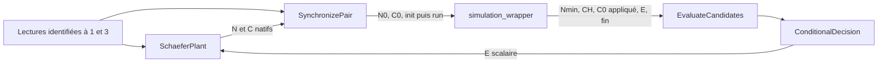

# Test 8E — Boucle halieutique générique observable et commandable

7 novembre 2026. Windows x64, MSVC, C++20, WITH_GUI=OFF. Aucun commit ni push.

## Audit préalable et manque reproduit

Rapports 7G, 8A, 8B, 8C, 8D ; exemples scientifiques v3 de ces tests ; article
local `docs/JFSMA26.pdf` (notamment 3.4–3.8, 4.1–4.5) ; catalogue, contrats,
compilateur hiérarchique, primitives événementielles et wrapper natifs examinés.
La distinction action/contextes de l'article et sa réinitialisation prospective
de C à zéro sont conservées dans l'interprétation de cette expérience.

`state_observer` sait lire indépendamment deux intégrateurs au même instant et
conserve les deux champs d'identification. `value_memory` mémorise par
(identité, campagne), et `event_operator(required=3)` joint deux champs sous
cette même clé. Deux opérateurs passe-valeur peuvent donc constituer une
barrière N/C sans nouvel atome de synchronisation. Une simple mémoire du
dernier message QSS ne constitue toujours pas une lecture de l'état continu.

En revanche, les entrées scalaires historiques du wrapper ignorent les clés :
chaque facteur conserve sa dernière valeur. Un run peut partir sans nouvelle
observation et les campagnes sont renumérotées suivant les runs réussis.
L'audit exécuté **avant** modification du moteur supprime l'entrée observée
du démonstrateur 8D : le runner réussit encore et les trois enfants déclarent
X initial = −777. Preuve : `build-web-test8e/audit-missing-input.log`.
Le premier essai d'audit comportait une cible de facteur dupliquée et a été
rejeté ; le constat ci-dessus provient de la requête corrigée, valide.

La composition seule protège le déclenchement normal, mais ne garantit pas
une transaction cohérente quand plusieurs cycles arrivent entrelacés au
wrapper, quand un run contourne la barrière, ou quand un premier cycle
incomplet est abandonné. Une extension native **optionnelle**, indépendante
du système représenté, répond à ce manque : `experiment.requiredInputs`.
Aucun nouveau type de dynamique ni composant T*, B*, B_pond ou B_contr.

## Transaction générique de facteurs

L'exemple déclare `requiredInputs: ["initialN", "initialC"]`. Le compilateur
résout ces noms vers un masque de ports, conservé dans `parameter.reals[1]`.
Les champs facteurs et les commandes portent `[valeur, 0, campagne]`.
Le port distingue les variables ; la campagne distingue les cycles. Le
wrapper stocke les champs dans sa propre ressource `embedded_simulation`,
jamais dans un pointeur vers le système principal ou dans React.

Règles natives, en mode complete :

- Campagne entière de 1 à 2^53−1 ; identité de transaction égale à 0.
- Au plus 128 trames de facteurs en attente ; au plus dix champs par trame.
- Toutes les entrées obligatoires du même cycle sont nécessaires avant init
  **et** run. Une commande prématurée est une erreur de protocole explicite.
- Tous les champs d'un sac sont reçus avant init, puis run. Une seule
  commande de chaque sorte par sac ; si les deux existent, même campagne.
- Deux valeurs différentes pour le même champ/cycle sont une erreur. Une
  duplication identique est idempotente ; aucun ordre arbitraire du sac ne
  détermine la valeur.
- Les facteurs non reçus dans la trame utilisent leur plan configuré ; aucun
  override d'un cycle précédent n'est réutilisé.
- Les runs portent des campagnes strictement croissantes, avec trous permis.
  Un run libère les trames antérieures et la sienne ; une arrivée périmée est
  rejetée. Les résultats individuels conservent le numéro demandé.
- init garde sa sémantique d'annulation des réponses différées ; initialize
  efface toutes les trames et remet les compteurs à zéro.

Sans cette option, ou avec une liste vide, le protocole historique 8A–8D
reste actif. Les modes partiels ne reçoivent pas une sémantique nouvelle.
L'interface propose une case « Recevoir ce facteur à chaque campagne » pour
chaque facteur. Renommer ou réordonner les facteurs remappe les références
et les ports ; les sauvegardes scientifiques et workspace conservent l'option.

## Architecture des définitions couplées

Exemple livré : `web/examples/decision-feedback-schaefer-v3.json`.
Génération reproductible : `node web/engine/runner/decision-8e-fixture.mjs --write`.
Le script construit des graphes et ne simule ni ne décide.



| Définition | Construction et rôle |
|---|---|
| SchaeferPlant | 15 atomes du Schaefer de référence, E constant remplacé par zero_order_hold ; deux state_observer ajoutés, soit 17 atomes |
| SchaeferProspect | Les 15 atomes / 18 connexions QSS3 de la référence 8B, avec N/C initiaux sentinelles remplacés par facteurs |
| SynchronizePair | Deux value_memory ; deux passe-valeur event_operator required=3 ; une seconde jointure ready ; multiplication par zéro pour init ; addition du délai pour run |
| ConditionalDecision | candidate_filter ; deux candidate_select lexicographiques ; selection_priority, réutilisant la composition 8C |
| EvaluateCandidates | Soustraction identifiée CH−C0 ; comparaison Nmin≥140 ; instance ConditionalDecision |

Les équations restent dN/dt=rN(1−N/K)−qaEN, dC/dt=qaEN.
N0=150, C0=0, r=0,35, InvK=1/300, a=1, q=0,001, E initial=260,
dQ=0,01. Les deux définitions Schaefer restent distinctes. Aucune équation
différentielle n'a été ajoutée au C++, aucun algorithme QSS n'a été modifié.

`campaign_aggregate` et `campaign_broadcast` ont été audités et leurs suites
8C sont rejouées. Ils ne sont pas nécessaires ici : le C0 effectivement
appliqué est déjà émis pour **chaque scénario**, ce qui évite de diffuser une
mémoire parent non adressée dans les campagnes prospectives.

## Correspondance des ports et des identités

| Définition | Entrées | Sorties |
|---|---|---|
| SchaeferPlant | 0 read, 1 action | 0 N, 1 C, 2 missingN, 3 missingC |
| SynchronizePair | 0 N, 1 C, 2 end | 0 N, 1 C, 2 init, 3 run |
| EvaluateCandidates | 0 Nmin, 1 CH, 2 C0, 3 E, 4 end | 0 action, 1 identity, 2 score, 3 selected, 4 taggedAction, 5 secondary, 6 end, 7 primarySelected, 8 secondarySelected |
| ConditionalDecision | 0 DeltaC, 1 Nmin, 2 E, 3 admissible, 4 end | Les mêmes neuf sorties que EvaluateCandidates |

F=3, S=2 pour le wrapper :

| Port | Sens scientifique |
|---|---|
| x0 / x1 | init / run, adressés par cycle |
| x2 / x3 / x4 | facteurs initialN / initialC / effort |
| y0 / y1 | Nmin / CH du gagnant interne |
| y2 / y3 / y4 | N0 / C0 / E du gagnant interne |
| y5 | statut individuel [valide, scénario, campagne] |
| y6 / y7 / y8 | N0 / C0 / E réellement appliqués à chaque enfant |
| y9 / y10 | Nmin / CH individuels |
| y11 | clôture [valides, total, campagne] |

cycle1 et cycle2 émettent [1,0,1] à t=1 et [1,0,2] à t=3. La même
commande rejoint les deux observateurs et les deux clôtures de jointure.
Les sorties de lecture sont [N,0,k] et [C,0,k], distinguées par leurs ports,
stockées séparément, puis adressées aux facteurs initialN et initialC du cycle k.
Les enfants 0/1/2 reçoivent chacun les deux états de k, avec E=80/150/260.
Leurs résultats portent [indicateur, scénario, k]. Il n'y a donc aucune
renumérotation silencieuse lorsqu'un cycle n'a pas pu être exécuté.

## Calcul et sélection par composition

`deltaC` reçoit y10 en a, y7 en b, y11 en end, operation=2, required=3.
Il calcule CH−C0 sous la clé (scénario, campagne), puis émet la fin après
toutes ses lignes. L'initialisation C0=0 est vérifiée dans une exécution
prospective distincte. C n'influe pas sur N ; la différence de quantification
entre deux origines de C est contrôlée à 0,03, sans modifier les équations.

`admissible` applique operation=10, right=140. Le filtre requiert DeltaC, E,
admissibilité et Nmin (masque 15). Le sélecteur principal maximise DeltaC,
puis Nmin en cas d'égalité. Le secondaire maximise Nmin puis DeltaC sur
tous les candidats. Les deux ont emitFallback=0 et requireSecondary=1.
selection_priority préfère la principale lorsqu'elle existe ; sinon il
transmet le **véritable E** et l'identité du candidat secondaire.

Score et secondary gardent l'ordre des critères de la branche utilisée :
DeltaC/Nmin pour la principale, Nmin/DeltaC pour la secondaire. Les sorties
primarySelected et secondarySelected permettent d'identifier la branche en
tenant compte des priorités configurées. Le statut final vaut 1 pour un
candidat réel, y compris le repli. Les sorties internes historiques du wrapper
restent observables, sans connexion à l'action du système principal.

## Chronologie native

Toutes les étapes d'un cycle sans délai restent à la même date logique :
commande identifiée ; réception simultanée par les deux observateurs ; lecture
native après le sac de la source ; émission N/C ; écriture des deux mémoires ;
jointures pairN/pairC ; facteurs reçus par le wrapper ; ready ; initValue ;
initialisation réelle des enfants ; runValue ; exécution locale [0,20] ; FIFO
des résultats individuels ; DeltaC et admissibilité ; clôtures des sélecteurs ;
arbitrage ; sortie E ; maintien ; propagation dans les opérateurs QSS.

Le test C++ `native-schaefer-feedback` charge le JSON livré avec le même
compilateur que le runner. Il compare chaque lecture à l'observation courante
de l'intégrateur, inspecte **avant run** X et les paramètres de chaque enfant,
conserve les numéros de sacs, vérifie chaque DeltaC identifié et relève les
émissions réelles du maintien. Les historiques rééchantillonnés ne servent pas
de trace DEVS. Les dates attendues du maintien sont exactement
(0,260), (1,150), (3,150), sans epsilon.

Chronologie relevée dans `logs/native-events.log` (numéro d'appel natif) :

| Étape | Cycle 1, t=1 | Cycle 2, t=3 |
|---|---:|---:|
| Émission simultanée N et C | 74 | 186 |
| Émission des mémoires | 76 | 188 |
| Émission des deux facteurs joints | 78 | 190 |
| Commande init émise | 82 | 194 |
| Init reçu ; X N/C inspectés dans les trois enfants | 83 | 195 |
| Commande run émise | 84 | 196 |
| Action E externe émise | 117 | 236 |
| Action identifiée [150,1,k] | 118 | 237 |
| Émission effective du maintien | 119 | 238 |

Une sortie d'un sac est reçue à l'appel suivant de l'ordonnanceur. L'inspection
des enfants est donc faite après **réception** d'init, et non dès son émission
ni dès l'arrivée du premier facteur. Une version initiale du test inspectait
trop tôt et voyait la sentinelle ; ce test a été corrigé sans modifier QSS.
Des récepteurs privés rendent les sorties identifiées non connectées du
décideur visibles au test natif ; ils ne participent pas au calcul de décision.

Deux tests directs supplémentaires placent les deux lectures sur des événements
réels de quantification QSS3, dans les deux ordres d'allocation des observateurs.
Le maintien est testé séparément avec 150 et 260 dans le même sac, dans les
deux ordres de connexion : une seule émission 260. Il ne s'agit pas d'une file
de deux actions. Des commandes dans des sacs successifs conservent la
sémantique de maintien historique.

## Oracle indépendant et tolérances

Les oracles sont exclusivement dans les tests. Pour E constant,
alpha=r−qaE, beta=r/K,
D=1+beta*N0*expm1(alpha*t)/alpha,
N=N0*exp(alpha*t)/D,
C=C0+qaE*log(D)/beta, avec limite continue si alpha=0.
L'oracle parent compose E=260 jusqu'à t=1 puis E=150 ; la deuxième décision
reconduit E=150. Les valeurs analytiques sont :

| Date | N | C |
|---:|---:|---:|
| 1 | 138,723549183127 | 37,473918001632 |
| 3 | 148,034332813976 | 80,550344478904 |
| 5 | 155,008187407170 | 126,060295771091 |

États effectivement observés et réappliqués aux **trois** enfants :

| Cycle | N(tk) = X initial enfant N | C(tk) = X initial enfant C | Branche utilisée | Identité | E appliqué |
|---:|---:|---:|---|---:|---:|
| 1 | 138,722797477662 | 37,474201388035 | secondaire | 1 | 150 |
| 2 | 148,032956366218 | 80,549582911628 | principale | 1 | 150 |

Ces X sont vérifiés directement dans les dynamiques natives après init,
avec les paramètres N/C, les efforts 80/150/260, dQ=0,01 et le stockage
indépendant du prototype. La seconde campagne dépend de l'action précédente :
une variante sans retour d'action conserve E=260 et suit un autre oracle.

| Cycle | Scénario | E | Nmin | CH total | DeltaC future |
|---:|---:|---:|---:|---:|---:|
| 1 | 0 | 80 | 138,722797478 | 372,695377104 | 335,221175716 |
| 1 | 1 | 150 | 138,722797478 | 525,092425402 | 487,618224014 |
| 1 | 2 | 260 | 83,248187791 | 552,393434572 | 514,919233184 |
| 2 | 0 | 80 | 148,032956366 | 420,305768537 | 339,756185625 |
| 2 | 1 | 150 | 148,032956366 | 576,338327038 | 495,788744126 |
| 2 | 2 | 260 | 83,770729392 | 608,549943482 | 528,000360570 |

Au premier cycle, les trois Nmin sont sous 140. Les scénarios 0 et 1 ont le
même minimum initial ; le second critère DeltaC choisit réellement le 1.
Le score émis est alors Nmin=138,722797478, secondary=487,618224014.
Au second cycle, 0 et 1 sont admissibles, et 1 maximise DeltaC :
score=495,788744126, secondary=Nmin=148,032956366.
Le wrapper interne maximise CH et retient 2/E=260 aux deux cycles ; cette
décision interne n'est pas l'action appliquée au système principal.

Le système principal termine avec **N(5)=155,007095478631** et
**C(5)=126,058376506886**, soit des écarts de −0,001092 et −0,001919
aux valeurs analytiques. Le maximum sur tous les points parent publiés est
0,011618 pour N et 0,013852 pour C. Le modèle complet effectue 274 appels
natifs à l'ordonnanceur ; les deux cycles sont finis à leur date logique.

Tolérance absolue 0,05 sur les trajectoires parent N/C et le minimum prospectif
Nmin, soit cinq quanta. Ce choix est vérifié sur tous les points parent publiés,
pas uniquement les trois dates de référence. Pour CH et DeltaC à H=20,
la tolérance est **0,25** (25 quanta, moins de 0,08 % des captures examinées).
La première tentative à 0,05 échoue réellement : l'enfant E=80 du premier
cycle donne CH=372,695377 contre 372,872158 analytique, écart 0,176781.
La simulation plate indépendante du wrapper donne exactement le même CH.
Le graphe et le quantum livré ne sont pas changés pour supprimer cet écart.

Un audit de convergence maintient le même état initial observé et les mêmes
équations, mais réduit le quantum dans des variantes de test uniquement :

| dQ, E=80, H=20 | Erreur max de N sur la trajectoire publiée | Erreur max de C |
|---:|---:|---:|
| 0,01 | 0,462596 | 0,176781 |
| 0,001 | 0,002385 | 0,000980 |
| 0,0001 | 0,000233 | 0,000100 |

Cet écart transitoire plus grand que dQ sur N prospectif ne doit donc pas
être assimilé à une borne globale d'erreur d'un quantum. Le minimum de ce
scénario croissant reste son état initial, et les critères ainsi que l'action
restent éloignés des frontières de comparaison. L'audit complet des trois
efforts est conservé dans `build-web-test8e/quantum-audit.jsonl` ; le test
automatisé reprend l'équivalence plat/enfant et la convergence du cas E=80.
L'application d'un même état à tous les enfants et les
soustractions identifiées sont comparées à 1e−10 ; l'effet sur la dérivée de N
à t=1 à 0,01. Les écarts mesurés et les résultats exécutés figurent ci-dessous.

## Six scénarios et contrôlabilité

Une validation complémentaire croise E=[80,150,260] et q=[0,0008,0,0010].
E reste le seul port d'action du système principal. q reste fixé à 0,001 dans
ce système. Les six résultats conservent leurs identités distinctes ; le
facteur qHypothesis est une **hypothèse prospective**, pas une commande.

Une variable d'action est une grandeur modifiable par le gestionnaire (ici E).
Un paramètre observé est une grandeur renseignée à partir d'une observation
ou estimation, sans impliquer sa contrôlabilité. Une hypothèse prospective
est une valeur postulée dans un scénario. Une source d'incertitude décrit
plusieurs valeurs ou une distribution plausibles d'un tel paramètre.

Sélectionner la meilleure ligne parmi les six puis projeter sur E décrit ici
un choix conditionnel au contexte de cette ligne. Ce n'est pas une politique
robuste à l'incertitude de q. Une décision robuste demanderait une agrégation
par E (pire cas, espérance justifiée, etc.) et une règle explicite. L'exemple
principal reste donc à q fixé. Aucune optimisation simultanée de E et q
n'est présentée comme une politique de gestion directement applicable.

## Vérifications exécutées

Les journaux complets sont conservés sous `build-web-test8e/`.

| Vérification | Release | Debug |
|---|---:|---:|
| Moteur, runner, clients historiques reconstruits avec les mêmes options | réussi | réussi |
| CTest runner, JSON, wrappers et primitives 8A–8E | 36/39 | 35/39 initialement + contrat 1/1 en reprise isolée ; trois échecs CSV restants |
| Tests officiels du moteur | 10/10 | 10/10 |
| Stabilisation historique 7A–7C | 40/40 | 40/40 |
| API, processus, HTTP historiques | 94/94 | 94/94 |
| JSON et HTTP scientifique 8B | 12/12 | 12/12 |
| JSON et HTTP scientifique 8C | 13/13 | 13/13 |
| JSON et HTTP scientifique 8D | 13/13 | 13/13 |
| JSON et HTTP scientifique 8E | 23/23, 36 requêtes/résultats comparés | 23/23, 36 requêtes/résultats comparés |
| Diagnostics scientifiques séparés / erreur de destination | 2/2 | 2/2 |
| Playwright complet | 63/63 | 63/63 |

Frontend : 139/139 Vitest, TypeScript et build Next.js de production réussis.
Les trois parcours 8E importent les deux cycles puis exportent/réimportent,
construisent un nouveau SchaeferPlant depuis les atomes QSS/hold/observers et
ses ports, et reconstruisent SynchronizePair/ConditionalDecision/EvaluateCandidates
avec les connexions et paramètres natifs. Le wrapper est configuré dans
l'inspecteur, notamment les deux entrées obligatoires, scenarioResults et H.
Les requêtes et résultats du navigateur sont comparés à une exécution directe
du même binaire. Les captures des définitions Plant et EvaluateCandidates ont
été inspectées ; aucun calcul décisionnel n'est ajouté au frontend.

Les trois échecs historiques sont `runner-wrapper-7g`,
`native-wrapper-schaefer-trajectories`, `native-wrapper-schaefer-pair`.
Ils exigent toujours le véritable `web/model-test/modelhalieutiquetest-points.csv`,
absent. Aucun test n'est ignoré et aucun CSV n'est synthétisé. Le code global
des scripts demeure 1, avec runner-tests=8 et les seize autres étapes à zéro.

Incidents de validation conservés : le helper natif initial supposait que
zero_order_hold définissait un membre statique outputs ; le helper de test
utilise maintenant la taille effective de y. Les premiers contrôles JSON
cherchaient chaque DeltaC dans des historiques qui ne gardent que la dernière
valeur à une même date ; cette preuve relève maintenant de la trace native
identifiée. Un premier test de boucle reliait un atome à lui-même, interdit
par le contrat ; il utilise désormais une boucle de deux atomes et constate
réellement maxRunCalls. L'import JSON du test Playwright a reçu l'attribut
ESM requis. Les journaux initiaux restent séparés des reprises.

Le premier parcours manuel a aussi révélé un défaut préexistant : un pas
d'observation **1** pour les intégrateurs N/C provoque un arrêt natif code 3,
stdout/stderr vides, puis HTTP RUNNER_PROTOCOL_ERROR. Le même document échoue
avec les anciens runners 8D Release et Debug ; il réussit avec un pas 0,1.
La reproduction est dans `ui-failed-request.json` et
`ui-sampling-diagnostic.json`. La cause interne n'est pas corrigée ici :
le parcours configure explicitement les six observations du Plant à **0,1**,
comme l'exemple livré. Cette limitation n'est ni qualifiée de succès ni
assimilée aux trois échecs CSV.

Le CTest Debug `runner-contract` a atteint sa limite historique de 60 secondes
pendant les validations concurrentes. Le journal initial et son JUnit sont
conservés. Après achèvement des autres campagnes et arrêt des serveurs de test,
la reprise isolée passe en **37,18 secondes**, sans augmenter le délai.
`contract-isolated.{log,xml}` complète la matrice initiale ; celle-ci conserve
ses quatre échecs initiaux et n'est pas réécrite en résultat sans timeout.

Preuves : `{Release,Debug}/logs/` contient les codes, JUnit, événements natifs,
HTTP 8B–8E et diagnostics ; `browser/` les documents construits et exports ;
`playwright-{release,debug}.{log,json}` les campagnes complètes ;
`cross-configuration.json` la comparaison des 36 cas, empreintes des exécutables
et bibliothèques et erreurs analytiques. `decision-8e-proof.mjs` vérifie les
résultats natifs/HTTP, les stderr valides vides, le même journal de sacs et les
options IRRITATOR_ENABLE_DEBUG sans NDEBUG dans le moteur Debug.
La vérification finale réussit : **36/36** requêtes/résultats strictement
identiques entre configurations, tous égaux aux réponses HTTP ; stderr=0 pour
les exécutions valides et trace native des sacs exactement identique.
Les deux serveurs créés sur 3300/3301 ont été arrêtés. Les captures historiques
suivies et les anciens rapports n'ont pas été remplacés.

## Limites et reproduction

Les enfants sont exécutés synchroniquement dans la transition native run.
Le chevauchement porte sur les trames reçues et les réponses différées,
pas sur deux calculs enfants parallèles. Sans init explicite, les réponses
déjà capturées gardent leurs facteurs et leurs résultats ; avec init,
une réponse en attente est annulée. Un init tardif exige lui aussi une trame
complète, et ne fabrique pas une action. Les runs de deux campagnes dans un
même sac sont rejetés explicitement dans le nouveau mode.

Il n'y a pas de mécanisme métier d'expiration d'une action différée. Des
réponses autorisées dans des ordres différents sont appliquées dans leur
ordre d'arrivée. Les mémoires du modèle et les trames incomplètes sont bornées ;
une utilisation indéfinie doit configurer leur capacité ou des resets explicites.
Les budgets de modèles, connexions, scénarios, points, résultats, processus
et maxRunCalls sont conservés. Les tests attendent une erreur bornée pour une
boucle instantanée volontaire. Aucun CSV historique 7G n'est reconstitué.

Reproduction PowerShell depuis la racine :

```powershell
./web/engine/runner/tests-wrapper/run-8e.ps1 -Configuration Release
./web/engine/runner/tests-wrapper/run-8e.ps1 -Configuration Debug
node web/engine/runner/decision-8e-proof.mjs
```

Si runner-contract atteint son délai historique, la reprise isolée utilisée ici
est `ctest --test-dir build-web-test8e/Debug/runner -R '^runner-contract$'
--output-on-failure --output-junit
D:/these/irritator/build-web-test8e/Debug/logs/contract-isolated.xml` ; relancer
ensuite le script de vérification des preuves. Aucun timeout n'est augmenté.

Le code global des scripts doit rester non nul tant que les trois tests
historiques 7G exigent leur véritable CSV absent. BuildOnly/TestsOnly séparent
la reconstruction et l'exécution. Pour le navigateur, compiler Next avec
IRRITATOR_API_URL=http://127.0.0.1:3301, lancer l'API sur 3301 et Next sur 3300,
définir FRONTEND_URL et IRRITATOR_RUNNER, puis lancer `npm run test:e2e` dans
`web/apps/frontend`. `decision-8e.spec.ts` cible les trois parcours 8E.
Les captures de régression sont dirigées vers le build, sans remplacer les
captures historiques suivies. Seule la plateforme Windows/MSVC est validée.
