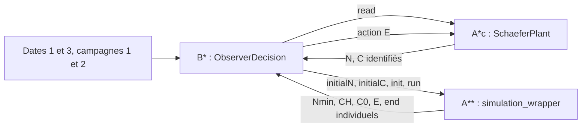

# Test 8F — Composition explicite de T* et encapsulation générique de B*

7 novembre 2026. Windows x64, MSVC, C++20, WITH_GUI=OFF. Aucun commit ni push.

## Résultat et périmètre

Le parent `web/examples/tstar-schaefer-three-coupled-v3.json` assemble
`plant : SchaeferPlant` (A*c), `observer : ObserverDecision` (B*) et
`forecast : simulation_wrapper` (A**). B* est une **définition couplée**
éditable dans React Flow. Aucun atome B*, aucune équation halieutique ni
politique scientifique n'est ajouté au moteur.

La définition SchaeferPlant et le prototype SchaeferProspect sont strictement
identiques à ceux de 8E. Le wrapper conserve complete, scenarioResults=true,
requiredInputs=[initialN,initialC], E=[80,150,260], q=0,001 et H=20.
Le parent évolue de 0 à 5, avec des décisions à 1 et 3. Les deux campagnes
donnent les mêmes états, critères et actions que 8E. Le défaut d'observation
à pas 1 est reproduit indépendamment du wrapper puis corrigé dans la
finalisation du rééchantillonneur, sans modification des algorithmes QSS.

## Audit des responsabilités et correspondance théorique

Références examinées : rapports 8A–8E, exemple 8E, article local
`docs/JFSMA26.pdf` §§3.4–3.8, interfaces DEVS natives, construction hiérarchique
`generic_component` / `project::set`, conventions des facteurs et campagnes,
`state_observer`, maintien, primitives événementielles et contrôles React Flow.

L'article (§3.7, équation 17) définit D={A*c,B*,A**} et le circuit
B*→demande→A*c→état→B*→plan→A**→résultats→B*→action→A*c.
Le parent exécutable ajoute à ces trois rôles les sources d'essai et les
récepteurs de preuve ; son ensemble D instrumenté contient donc aussi ces
atomes auxiliaires. Ils ne portent pas de règle d'évaluation ou de sélection.
En 8E, le parent adressait directement les observateurs, puis raccordait
SynchronizePair, le wrapper et EvaluateCandidates. Les deux dernières
définitions exprimaient des fonctions de B*, sans constituer une interface
unique d'observateur-décideur.

| Fonction | Position 8E | Position 8F |
|---|---|---|
| Dates et identités externes | constantes et event_tag parent | mêmes sources, reçues uniquement par B* |
| Demande d'observation | source parent directement vers Plant | request dans B*, sortie read vers Plant |
| Lecture de N/C courants et application de E | SchaeferPlant | SchaeferPlant inchangé |
| Mémoires, jointure N/C, préparation des facteurs et init/run | SynchronizePair dans le parent | observer/synchronize |
| CH−C0, contrainte et sélection conditionnelle | EvaluateCandidates dans le parent | observer/decide |
| Simulation et plan statique | wrapper parent | wrapper parent distinct de B* |
| Sources initiales, récepteurs et graphiques | parent | parent ; aucun calcul de décision |

B* est décrit atomiquement au §3.4, mais l'article autorise explicitement
sa décomposition couplée (§3.1). Ici son état est le produit des mémoires,
tables identifiées, barrières et FIFO de ses composants. Les phases
observation, préparation, évaluation et action sont réalisées par les
connexions et les états DEVS des primitives, sans automate scientifique
monolithique. L'ordonnanceur existant conserve ses sacs et ses règles de
confluence ; aucun SELECT ni epsilon temporel spécifique n'est ajouté.

## Diagnostic préalable du défaut d'échantillonnage

Preuves avant correction : `build-web-test8f/sampling-before.json`, requêtes
`audit-{full,flatN,flatC}-{0.1,1}.json`, `observation-before-all.log` et
`observation-repro-build.log`. Les anciens exécutables 8E et leurs preuves
restent intacts.

| Reproduction avec le runner 8E Release | Pas 0,1 | Pas 1 |
|---|---:|---:|
| Document du défaut React Flow 8E | code 0 | code 3, stdout/stderr vides |
| Schaefer plat, N seul observé | code 0 | même arrêt |
| Schaefer plat, C seul observé | code 0 | même arrêt |

La reproduction C++ `observation-native-tests.cpp` se réduit à un observer,
un resampler QSS3 et deux dates d'observation : (0,0,pente=1) et
(2,3,pente=2). La dernière valeur à t=2 est écrite deux fois pour contrôler
aussi la stabilisation d'un même instant. Aucun modèle Schaefer, scheduler,
wrapper, enfant, JSON ou processus de runner n'est nécessaire. Avec l'ancienne
bibliothèque, le pas 1 publie (0,0), (1,1), **(2,2), (2,3)**.
Les pas 0,25, 0,5 et 2 reproduisent également le doublon ; le pas 0,1 réussit
ici parce que son addition flottante ne tombe pas exactement sur la borne.
Ce comportement explique la dépendance au pas, sans invoquer une instabilité
scientifique du modèle.

La chaîne causale est double :

1. `tick(+inf)` confirme le dernier point par interpolation, y compris une
   éventuelle date de grille exactement égale à la borne finale ; finalize
   ajoute ensuite la **vraie valeur native** à cette même date. En QSS3,
   l'extrapolation quadratique depuis le point précédent peut différer de
   cette valeur. La déduplication par valeur ne supprime pas ce doublon de date.
2. Le runner rejette correctement les dates non strictement croissantes,
   mais appelait `fail()` depuis le callback de `observer::read_history`,
   déclaré noexcept. L'exception déclenche terminate/abort avant l'enveloppe
   JSON et le diagnostic du main ; l'API constate RUNNER_PROTOCOL_ERROR.

Un binaire d'audit reprend le main de HEAD avec la bibliothèque 8E et ajoute
uniquement un handler terminate de diagnostic. Il restitue exactement
`TERMINATE OBSERVATION_ERROR: Non-finite or unordered history` avant de sortir
avec le code d'audit 90 (`audit-terminate.json`). Le handler ne fait pas partie
du runner livré. La reproduction native liée à la bibliothèque corrigée
termine avec NATIVE_OBSERVATION_PASS (`observation-after.log`).

Il s'agit donc d'une collision **grille/bord final dans l'observation native**,
puis d'un défaut de propagation d'erreur à la sérialisation. La quantification
explique que les deux valeurs puissent différer ; elle n'est pas corrigée ni
remplacée. Aucune erreur mémoire ni défaillance du lancement de processus
n'est nécessaire pour reproduire le défaut.

Correction minimale : `tick(+inf)` finalise directement ;
`commit_pending(sealing=true)` conserve les points de grille **strictement
intérieurs**, puis finalize publie la valeur native à la borne finale.
L'interpolation intérieure, les grilles, les observations intermédiaires,
la déduplication par valeur et les algorithmes QSS1/2/3 restent inchangés.
Dans le runner, les contrôles faits sous read_history mémorisent le motif
d'erreur ; `fail()` est appelé après retour du callback. Aucun résultat
scientifique de substitution ni interception d'un arrêt natif n'est ajouté.

Conséquence diagnostique explicite : la puissance fractionnaire d'une entrée
négative reste rejetée et ne renvoie aucune observation partielle, mais son
historique non fini donne maintenant HTTP 422/OBSERVATION_ERROR au lieu de
l'ancien HTTP 502/RUNNER_PROTOCOL_ERROR dû à terminate. L'assertion du test
historique `qss-catalog.test.ts` exige désormais ce rejet explicite ; elle
n'accepte plus l'ancien arrêt comme résultat attendu. La campagne API Release
initiale 93/94 et sa reprise ciblée corrigée restent dans deux journaux séparés.

La régression native contrôle 0,1/0,25/0,5/1/2, les valeurs intérieures,
la valeur finale native, les écritures successives au même instant et
l'idempotence de finalize. La régression JSON/HTTP contrôle le Schaefer plat
N/C et le modèle complet aux cinq pas, avec identité des résultats prospectifs
et des états finaux. Le parcours navigateur exécute et réimporte N/C au pas 1.

## Interfaces formelles et contrats

Pour chaque définition couplée, on réutilise
⟨X,Y,D,{Md},EIC,EOC,IC,SELECT⟩ avec les ports ci-dessous et les connexions
du JSON. Les modèles internes sont des DEVS atomiques existants ou des
instances de définitions partagées ; le compilateur conserve des états natifs
distincts pour chaque occurrence.

### A*c — SchaeferPlant

| Sens | Ports et contrat |
|---|---|
| Entrées | 0 read=[1,0,k] ; 1 action=[E,0,0] |
| Sorties | 0 N=[N(t),0,k] ; 1 C=[C(t),0,k] ; 2 missingN ; 3 missingC |
| État | N, C, états QSS des opérateurs, action maintenue |

17 atomes : les 15 du Schaefer de référence, E constant remplacé par
zero_order_hold, et deux state_observer. Les deux intégrateurs restent QSS3,
dQ=0,01. N0=150, C0=0, r=0,35, InvK=1/300, a=1, q=0,001 ; E0=260
est envoyé explicitement par initialCommand à t=0. Les équations restent
dN/dt=rN(1−N/K)−qaEN et dC/dt=qaEN.

La demande read est distribuée aux deux observateurs ; leurs connexions source
lient les vrais intégrateurs N/C. La lecture utilise l'état natif courant,
après le sac reçu. Le maintien conserve l'action entre deux sacs. S'il reçoit
plusieurs actions dans un même sac, sa sémantique native de maximum est
conservée ; aucune sérialisation de ces commandes n'est inventée. A*c ne
connaît ni le seuil, ni les candidats, ni les règles de B*.

### B* — ObserverDecision

| Sens | Ports dans l'ordre |
|---|---|
| Entrées | 0 trigger, 1 N, 2 C, 3 Nmin, 4 CH, 5 C0, 6 E, 7 end, 8 reset |
| Sorties | 0 read, 1 initialN, 2 initialC, 3 init, 4 run, 5 action, 6 identity, 7 score, 8 selected, 9 taggedAction, 10 secondary, 11 end, 12 primarySelected, 13 secondarySelected |

trigger=[1,0,k], k entier strictement positif. Le premier champ 1 sert aussi
de clôture attendue d'une paire d'états. request est un event_operator identité,
qui **émet** read ; les sources parent n'ont aucune connexion directe à
plant.read. N et C portent la même clé (0,k), mais des ports différents.
Les résultats prospectifs portent (scénario,k). Les fins comptent les lignes
distinctes, jamais les messages dupliqués.

| Sous-modèle | Primitives et responsabilités |
|---|---|
| request | un event_operator identité ; émission de la demande |
| SynchronizePair | deux value_memory ; pairN et pairC exigent les deux états ; ready joint les sorties ; initValue=0 puis runValue=delay |
| EvaluateCandidates | deltaC=CH−C0 sous la clé (scénario,k) ; admissible=Nmin≥140 ; ConditionalDecision |
| ConditionalDecision | candidate_filter, deux candidate_select lexicographiques, selection_priority |

Les deux mémoires émettent après écriture. PairN et pairC attendent leurs
deux champs de la même campagne. Les facteurs sont envoyés avant init, puis
run est préparé dans un sac ultérieur à la même date. Les résultats sont
mémorisés par les jointures et sélecteurs jusqu'à leurs clôtures complètes.
La branche principale maximise DeltaC, puis Nmin, sur les admissibles ; la
secondaire maximise Nmin, puis DeltaC, sur tous les candidats. Les deux
sélecteurs ont emitFallback=0 : l'action provient d'une ligne réelle.

Le reset explicite est distribué aux mémoires, opérateurs, filtre, sélecteurs
et priorité ; il annule leurs états et FIFO locales. Il ne réinitialise pas
le Plant et n'annule pas à lui seul une réponse déjà capturée dans A**.
Cette annulation reste une commande init du wrapper, soumise à sa transaction
complète. Un redémarrage complet réinitialise tous les modèles et compteurs.

### A** — simulation_wrapper distinct

| Ports | Contrat |
|---|---|
| x0, x1 | init=[0,0,k], run=[delay,0,k] |
| x2, x3, x4 | facteurs initialN, initialC, effort ; les deux premiers sont obligatoires |
| y0..4 | Nmin, CH, N0, C0, E du gagnant interne historique |
| y5 | statut individuel [valide,scénario,k] |
| y6..8 | N0, C0, E réellement appliqués à chaque enfant |
| y9, y10 | Nmin et CH individuels bruts |
| y11 | clôture [valides,total,k] |

Le prospectif conserve ses 15 atomes QSS et son horloge locale [0,20].
Les X sentinelles −777/−888 sont remplacés par les facteurs du même cycle
**avant** l'exécution de chaque enfant. Le wrapper conserve l'objectif interne
simple/maximize/CH, mais ses sorties gagnantes ne commandent pas A*c.
Seuls les résultats individuels alimentent l'évaluation externe.

Comme en 8E, C0 est la capture cumulée observée et B* calcule CH−C0. L'exemple
numérique de l'article remet C0 à zéro pour mesurer directement la capture
future. La comparaison 8E entre ces deux origines de C est rejouée ici avec
sa tolérance 0,03 ; la quantification ne rend pas ces deux simulations
strictement identiques. Le cas principal demandé garde l'origine observée.

Le contrat requiredInputs de 8E reste inchangé : trames par campagne, init et
run seulement après réception de initialN/initialC, conflits et reprises périmées
rejetés, campagnes strictement croissantes avec trous permis. Une clôture
précoce n'autorise pas une décision avec des champs manquants.

## Connexions du parent



| Liaison | Ports |
|---|---|
| cycle1/cycle2→observer | 0→0 |
| observer→plant | read 0→0 ; action 5→1 |
| plant→observer | N 0→1 ; C 1→2 |
| observer→forecast | 1→2 ; 2→3 ; 3→0 ; 4→1 |
| forecast→observer | 9→3 ; 10→4 ; 7→5 ; 8→6 ; 11→7 |

Les sorties de preuve de B* alimentent des récepteurs parent ; internalE
observe séparément le gagnant historique du wrapper. Les chemins graphiques
incluent observer/request, observer/synchronize/memoryN, memoryC et
observer/decide/deltaC. Les définitions restent modifiables dans les inspecteurs
et par création de connexions React Flow ; aucun calcul n'est fait dans HTTP.

## Chronologie native et preuve scientifique

Le test C++ `native-tstar-composition` utilise le même compilateur v3 que le
runner. Il suit les sorties pendant les appels sim.run, compare chaque lecture
à la fonction native observation de l'intégrateur, inspecte les paramètres et
**X initial des trois enfants après réception d'init**, vérifie toutes les
soustractions CH−C0 et les émissions effectives du maintien. Il contrôle que
la demande provient de B* et précède les lectures. Les courbes rééchantillonnées
ne servent pas à déduire ces événements.

Ordre causal à tk, sans epsilon : source identifiée → request de B* → demande
au Plant et clôture de la paire → lectures natives simultanées N/C → mémoires
→ jointures pairN/pairC → facteurs du wrapper → ready → initValue → réception
d'init et inspection des enfants → runValue → run natif local [0,20] → FIFO
des lignes individuelles → DeltaC/admissibilité → clôtures → sélection/priorité
→ action → maintien et propagation QSS dans le Plant.

Numéros d'appels natifs du modèle composé (ils ne sont pas des dates) :

| Étape | Cycle 1, t=1 | Cycle 2, t=3 |
|---|---:|---:|
| Demande émise par B* | 73 | 187 |
| N et C émis simultanément | 76 | 190 |
| Mémoires | 78 | 192 |
| Facteurs joints | 80 | 194 |
| init émis | 84 | 198 |
| Init reçu ; X des trois enfants inspectés | 85 | 199 |
| run émis | 86 | 200 |
| Action scalaire de B* | 119 | 240 |
| Action identifiée | 120 | 241 |
| Commande réellement émise par le maintien | 121 | 242 |

Les 278 appels terminent les deux cycles aux mêmes instants logiques ;
8E en comptait 274. L'étape request et la traversée de son interface ajoutent
deux sacs par cycle, sans déplacement temporel ni changement scientifique.

| Cycle | N observé et X initial enfant N | C observé et X initial enfant C | Branche | Scénario | E appliqué |
|---:|---:|---:|---|---:|---:|
| 1, t=1 | 138,722797477662 | 37,474201388035 | secondaire | 1 | 150 |
| 2, t=3 | 148,032956366218 | 80,549582911628 | principale | 1 | 150 |

| Cycle | Scénario | E | Nmin | CH total | DeltaC |
|---:|---:|---:|---:|---:|---:|
| 1 | 0 | 80 | 138,722797478 | 372,695377104 | 335,221175716 |
| 1 | 1 | 150 | 138,722797478 | 525,092425402 | 487,618224014 |
| 1 | 2 | 260 | 83,248187791 | 552,393434572 | 514,919233184 |
| 2 | 0 | 80 | 148,032956366 | 420,305768537 | 339,756185625 |
| 2 | 1 | 150 | 148,032956366 | 576,338327038 | 495,788744126 |
| 2 | 2 | 260 | 83,770729392 | 608,549943482 | 528,000360570 |

Au premier cycle aucun scénario n'est admissible ; le second critère de
la branche secondaire départage E=80 et E=150. Au second, E=80 et E=150 sont
admissibles ; la branche principale retient E=150. Le wrapper historique
retient E=260 aux deux cycles, sans connexion à l'action du Plant.
Le maintien émet exactement (0,260), (1,150), (3,150).

État final natif : **N(5)=155,007095478631**,
**C(5)=126,058376506886**. Les valeurs et dates des résultats individuels
et les historiques du Plant sont identiques à 8E ; seuls les numéros de sacs
changent avec l'étape request supplémentaire. Les oracles analytiques
indépendants et les tolérances 8E sont conservés : 0,05 pour les trajectoires
parent et Nmin, 0,25 pour CH/DeltaC à H=20, 1e−10 pour la réapplication
des états et l'équivalence architecturale. L'erreur transitoire QSS3 du
prospectif E=80 à dQ=0,01 documentée en 8E reste présente et n'est pas
transformée en borne globale d'un quantum.

La comparaison avec l'archive **antérieure** 8E Release
`logs/http-8e/two-cycles.json` confirme aussi l'égalité exacte des dates et
valeurs de tous les événements prospectifs, au-delà de la comparaison entre
les deux architectures sur le nouveau runner : écart maximal 0
(`build-web-test8f/legacy-8e-comparison.json`).

## Déclenchement périodique et indépendance

`periodicTstar()` remplace les sources externes par un graphe interne à B*.
L'audit du generator natif montre `sigma += ta` : seul, avec period=1,
il émet à 1,3,6,... et ne représente donc pas une période constante.
Sans changer ce composant, un compteur construit avec event_operator et
value_memory produit k ; event_tag applique k à la demande. Une branche
générique calcule −min(k−1,1) et la transmet à add-delay après chaque tick :
correction 0 au premier tick, puis −1. Les délais suivants restent 2.
Les tests vérifient 1 et 3 sur [0,5], puis **1,3,5** sur [0,6].
Le graphe reste passif entre les ticks ; sa rétroaction ne déclenche pas
de boucle instantanée infinie. L'entrée trigger externe doit rester inutilisée
dans cette variante pour éviter deux sources de campagnes concurrentes.
Un reset local du compteur périodique ne remet pas à zéro les campagnes du
wrapper : pour recommencer à k=1 il faut redémarrer le modèle complet ; une
réutilisation de k périmé est explicitement rejetée par le protocole 8E.

Les validations couvrent remplacement de la définition B* par
ObserverConservative, seuil 0, minimisation des sélecteurs, dates 0,5/2,5,
absence de déclenchement ou d'un état, source native manquante, résultats
prospectifs incomplets, observation retardée par plusieurs sacs, reset d'une
paire incomplète, campagnes invalides/périmées/conflictuelles, réponse différée,
annulation par init, réponses chevauchantes sans init et redémarrage complet.
Une boucle volontaire est arrêtée par maxRunCalls. Les parcours React Flow
créent une nouvelle définition B*, ses ports, ses trois enfants et leurs
connexions, remplacent l'instance, modifient seuil/stratégie et exportent/réimportent.

## Six scénarios et limites par rapport à T*

Le démonstrateur principal garde q fixé. Une variante de contrat croise
E=[80,150,260] et qHypothesis=[0,0008,0,001] : B* conserve son interface,
seuls les raccordements des ports dynamiques du wrapper sont remappés
(Nmin=11, CH=12, C0=8, E=9, end=13). Les six identités sont distinctes.
qHypothesis n'est relié à aucun port d'action ; q du Plant reste 0,001.

Regrouper par E demanderait de joindre chaque identité à sa valeur E, puis
de réduire les hypothèses de q partageant cette action, avec une convention
explicite de clôture de groupe. On pourrait ensuite choisir un minimum,
une moyenne pondérée par des probabilités justifiées ou un autre critère
configuré avant la sélection d'E. Les agrégateurs actuels réduisent une
campagne, pas automatiquement les sous-groupes par valeur de facteur.
Ce routage/groupement et la justification scientifique d'une règle robuste
ne sont pas livrés. Choisir une ligne parmi six reste une décision
conditionnelle à cette hypothèse, pas une politique robuste.

**Limite fondamentale du plan :** sa structure (définition prospective,
facteurs, domaines de scénarios, horizon, critères et objectif interne)
reste configurée dans le wrapper. B* fournit les états et les commandes
dynamiques ; il n'envoie pas un Pk arbitraire capable de restructurer les
scénarios à chaque cycle. Ce n'est donc pas encore le contrat général
parameters→Pk des §§3.5/3.8. Le wrapper garde aussi son optimiseur historique,
alors que l'article décrit un retour sans évaluation décisionnelle interne ;
la décision appliquée ici est entièrement externe.

A*c ne possède pas le port général de reset d'état décrit au §3.3 ; seul
le redémarrage du modèle réinitialise N/C. Le reset de B* est local, sans
expiration métier d'une action différée. Les enfants sont calculés
synchroniquement dans la transition native run, même lorsque la restitution
est différée. La mémoire et les trames sont bornées (capacités configurables,
128 par défaut) ; des cycles indéfinis demandent des resets ou capacités
adaptés. Les budgets et les erreurs explicites restent actifs.

## Validation et reproduction

Les preuves sont conservées sous `build-web-test8f/`, séparément de 8E.

| Vérification | Release | Debug |
|---|---:|---:|
| Moteur, runner et clients historiques reconstruits avec les mêmes en-têtes/options | réussi | réussi |
| CTest runner, JSON, wrappers, primitives 8A–8F | 39/42 | 38/42 initialement ; contrat repris isolément 1/1 |
| Tests officiels du moteur | 10/10 | 10/10 |
| Stabilisation historique 7A–7C | 40/40 | 40/40 |
| API/processus/HTTP historiques | 93/94 initialement ; unique cas repris 1/1 après correction de l'assertion 502→422 | 94/94 |
| JSON/HTTP scientifique 8B | 12/12 | 12/12 |
| JSON/HTTP scientifique 8C | 13/13 | 13/13 |
| JSON/HTTP scientifique 8D | 13/13 | 13/13 |
| JSON/HTTP scientifique 8E | 23/23 | 23/23 |
| JSON/HTTP scientifique 8F | 20/20, 42 requêtes/résultats comparés | 20/20, 42 requêtes/résultats comparés |
| Diagnostics scientifiques séparés et destination invalide | 2/2 | 2/2 |
| Playwright complet, Chrome et React Flow | 66/66 | 66/66 |

Frontend indépendant du mode du moteur : **140/140 Vitest**, TypeScript et
build Next.js de production réussis. Les trois parcours 8F contrôlent le
pas 1 et son réimport, construisent une nouvelle définition B* et toutes ses
connexions, puis changent seuil et stratégie dans les inspecteurs. Leurs
réponses HTTP sont comparées à l'exécution directe du même binaire. La capture
`browser/observer-from-react-flow.png` a été inspectée. Les captures historiques
suivies dans reports n'ont pas été remplacées.

Le CTest Debug runner-contract a atteint sa limite **inchangée de 60 s**
pendant les campagnes simultanées. Après leur achèvement et l'arrêt des deux
serveurs de test, sa reprise isolée passe en **36,88 s**. Le XML initial
conserve les quatre échecs ; `Debug/logs/contract-isolated.{log,xml}` conserve
la reprise, sans réécriture de l'historique. De même, le journal API Release
initial conserve 93/94 et l'ancienne assertion 502 ;
`Release/logs/api-qss-corrected.log` conserve la reprise 1/1 exigeant
422/OBSERVATION_ERROR, sans observations partielles.

Les trois échecs historiques restants sont exactement
`runner-wrapper-7g`, `native-wrapper-schaefer-trajectories` et
`native-wrapper-schaefer-pair`, tous dépendants du véritable CSV 7G absent.
Les suites natives d'objectifs et les contrôles analytiques/plat-enfant ne
sont pas remplacés par un oracle inventé. Les scripts complets restent de
code global 1 ; leurs résultats initiaux et reprises restent explicites.

`decision-8f-proof.mjs` réussit : **42/42 cas 8F** et **36/36 cas 8E**
strictement identiques entre Release et Debug, et égaux aux réponses HTTP.
Les stderr des exécutions valides sont vides. La trace native composée est
exactement identique entre les deux configurations. Le fichier
`cross-configuration.json` conserve les empreintes des exécutables et
bibliothèques, les statuts réels, les enfants initialisés, les critères,
les numéros de sacs et les états finaux ; les options Debug avec
IRRITATOR_ENABLE_DEBUG et sans NDEBUG sont vérifiées. Les serveurs de test
créés sur 3300/3301 ont été arrêtés. Seule la plateforme Windows/MSVC est validée.

```powershell
node web/engine/runner/decision-8f-fixture.mjs --write
./web/engine/runner/tests-wrapper/run-8f.ps1 -Configuration Release
./web/engine/runner/tests-wrapper/run-8f.ps1 -Configuration Debug
node web/engine/runner/decision-8f-proof.mjs
```

BuildOnly/TestsOnly séparent reconstruction et exécution. Les scripts rejouent
les tests historiques, les suites JSON/HTTP 8B–8F et les diagnostics séparés.
Pour le navigateur : compiler Next avec IRRITATOR_API_URL=http://127.0.0.1:3301,
lancer Fastify sur 3301 avec IRRITATOR_RUNNER pointant sur le binaire choisi,
puis Next sur 3300. Définir FRONTEND_URL, IRRITATOR_RUNNER,
IRRITATOR_BROWSER_EVIDENCE, IRRITATOR_BROWSER_SCREENSHOTS et
IRRITATOR_PLAYWRIGHT_REPORT vers le build de validation, puis exécuter
`npm run test:e2e` dans `web/apps/frontend`. La preuve complète attend les deux
rapports `playwright-release.json` et `playwright-debug.json` à la racine du build.

En cas de timeout, la reprise utilisée est
`ctest --test-dir build-web-test8f/Debug/runner -R '^runner-contract$'
--output-on-failure --output-junit
D:/these/irritator/build-web-test8f/Debug/logs/contract-isolated.xml`.
Le CSV `web/model-test/modelhalieutiquetest-points.csv` reste absent : les trois
tests historiques 7G qui le nécessitent conservent leur échec réel.
Aucun CSV n'est reconstitué, aucun ancien échec n'est effacé, aucun test
n'est ignoré. Aucun commit ni push n'est créé.
