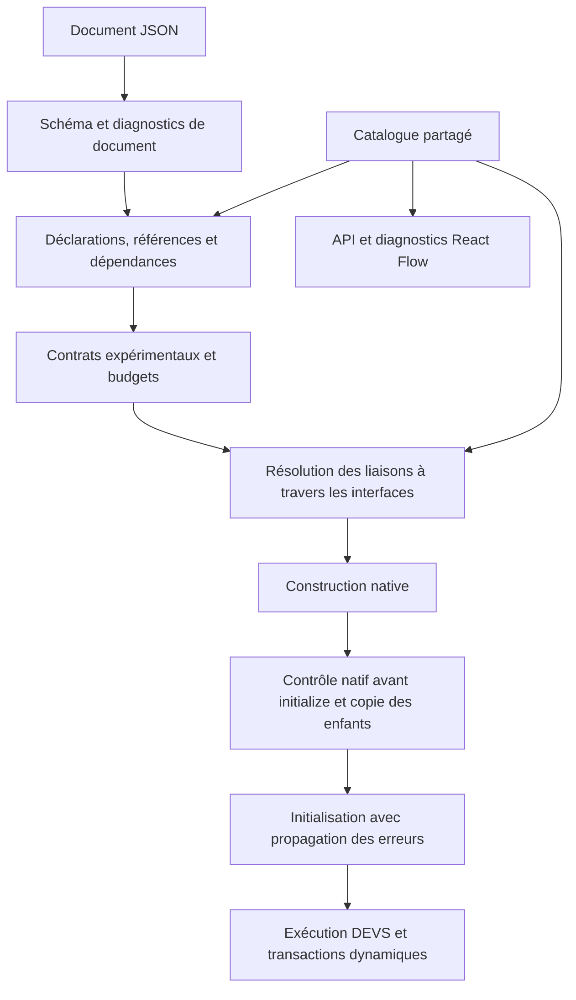

# Test 8K — Validation structurelle des modèles DEVS

10 novembre 2026, Windows x64/MSVC, C++20, WITH_GUI=OFF. Aucun commit ni push.

## Cause native établie avant correction

Les journaux 8J `audit/structural-before.json` et
`Release/targeted-direct/structural-child.json` indiquent 3221225477
(0xC0000005), sans réponse JSON. Ils restent inchangés. La reproduction 8K
est conservée dans `build-web-test8k/audit/before-{Release,Debug}-{flat,wrapper}.json`.
Le graphe plat retourne INITIALIZATION_ERROR, catégorie 3/code 70 ; le même
prospectif encapsulé plante en Release et avorte en Debug.

La pile `audit/stack-before.log`, obtenue par un banc indépendant lié à la
bibliothèque Debug 8J, établit :

```
state_observer.initialize -> event_protocol_error
embedded_sims_init -> simulation_wrapper_embedded_simulation_initialization_error
expected<void>::and_then -> statut retourné ignoré
simulation_wrapper.initialize -> état initialized malgré l'échec enfant
run_complete -> simulation.run -> output_port.for_each
scheduller.update -> handle == invalid_heap_handle
```

Le rejet de state_observer existait déjà. Le défaut causal est dans les quatre
surcharges de `expected<void>::and_then` : elles invoquaient le callback,
ignoraient son résultat et construisaient un succès. L'observateur n'avait donc
pas été inscrit dans l'ordonnanceur après son initialisation refusée ; la
première émission de la constante vers son entrée sollicitait un handle
invalide. Debug déclenche `debug::ensure` à core.hpp:11602 (numérotation avant
correction) ; Release atteint un accès mémoire invalide. Ce n'est pas un cast
de constante en intégrateur, ni une équation QSS à modifier.

Le banc de pile ne récupère pas le processus : il imprime la pile puis laisse
l'avortement se terminer. Aucun handler d'accès mémoire n'est livré dans le
runner de production. Aucun résultat scientifique n'est créé en cas d'erreur.

## Correction minimale et invariants

`and_then` restitue maintenant le résultat du callback et propage l'erreur
sans invoquer les étapes suivantes. Les callbacks void historiques restent
admis ; les callbacks retournant expected<T> conservent leur valeur. Le banc
C++ vérifie les quatre qualifications de référence et l'arrêt de la chaîne.

L'initialisation échouée doit rester fatale : elle n'établit ni handle valide,
ni simulation utilisable. Aucune reprise d'un ordonnanceur partiellement
initialisé n'est autorisée. Les codes historiques ne sont pas renumérotés ;
state_observer_source_error est ajouté en fin d'énumération (3/72).

Une validation native sans allocation, `validate_structure`, contrôle les
liaisons avant `simulation::initialize` (avant clean et toutes les mutations)
et avant `embedded_sims_alloc` (avant copie d'un scénario). Elle contrôle aussi
les prototypes des ressources imbriquées. Le contrôle historique dans
state_observer.initialize reste actif. Les indices de ports de simulation.connect
sont vérifiés avant tout accès à dyn.y dans can_connect. Le rejet demeure
natif même si JSON, Fastify et React Flow sont contournés.

state_observer.source lie zéro ou un intégrateur QSS1/2/3 ; plusieurs liaisons
sont ambiguës. Sans source, le contrat missing reste valide. Les notifications
quantifiées sur source ne remplacent pas l'observation continue native. Les
constantes restent valides sur read/reset, comme dérivées d'intégrateurs, comme
facteurs et pour les composants acceptant leurs messages. Les trois intégrateurs vérifient X fini et dQ fini strictement positif avant leur initialisation. La capacité 1–4096
borne les lectures/réponses ; elle ne donne pas un type de source différent.

Les équations, signatures des ports historiques, ordres des sacs, transitions
confluentes, événements simultanés, clôtures, identités et délais ne changent
pas. Une boucle de connexions n'est pas une récursion de définitions. Le
validateur ne rejette pas les boucles de rétroaction DEVS.

## Architecture et diagnostics

Le catalogue JSON partagé décrit types atomiques, ports orientés, paramètres
requis/domaines et sourceContracts. Ce dernier champ encode les types et la
cardinalité de la liaison source. Le compilateur C++ embarque ce catalogue ;
l'API et l'éditeur utilisent le même document, avec contrôle de parité dans
les tests. Les invariants de ressources restent vérifiés dans libirritator.
La sécurité ne repose donc pas sur TypeScript.

Le précontrôle n'alloue aucun projet et n'exécute aucune étape scientifique.
Il vérifie les identifiants, types, références, paramètres, ports, cibles de
facteurs/sélections/objectifs, options execution puis suit les interfaces
couplées jusqu'aux atomes source/destination. Il visite les occurrences
couplées et les définitions prospectives, ainsi que les définitions inutilisées.
Les déclarations sont vérifiées avant les références, puis les dépendances et dimensions du wrapper avant les calculs de ports. Les codes historiques INVALID_MODEL, INVALID_EXPERIMENT et UNSUPPORTED_EXPERIMENT restent ainsi prioritaires pour leurs contrats respectifs.

Les validations v1/v2/v3 existantes restent responsables des domaines des plans,
cardinalités, modes, méthodes, objectifs pondérés, dépendances, budgets,
requiredInputs et enveloppes dynamicPlan. Les plans produits à l'exécution
restent soumis aux transactions 8H/8I ; aucune valeur dynamique n'est prédite.

Chaque nouveau diagnostic comporte code stable, severity, path, definition,
instance, connection, parameter, found, expected et message. Les champs sans
objet valent null. Une erreur bloque ; aucun avertissement bloquant n'est
introduit. Le résultat est ordonné et rend la première incompatibilité ; il
peut être relancé après chaque correction.

Exemple : STATE_OBSERVER_SOURCE_TYPE, path
`forecast/@Prospect/deep/inner/readState`, definition Leaf, instance readState,
found constant, expected qss1_integrator|qss2_integrator|qss3_integrator. Les
segments avant @ identifient l'occurrence de wrapper ; après @, les occurrences
couplées et l'atome dans son prospectif. Une définition inutilisée est préfixée
par @Definition. connection conserve les endpoints de la connexion JSON qui
établit la liaison ; à travers une interface, cette connexion peut appartenir
à la portée appelante.

Les erreurs de déclaration peuvent être émises sous @Definition/... même pour une définition utilisée : elles concernent toutes ses occurrences. Les liaisons source suivent ensuite les occurrences complètes. Les erreurs JSON de schéma gardent leur pointeur de document. Les validations
historiques qui n'ont pas encore de diagnostic enrichi gardent leur code et
explication historiques ; cette limite est distinguée des règles enrichies.

Un tirage lognormal structurellement admissible peut produire un facteur non
fini. Avec la propagation corrigée, la primitive refuse initialize et le
wrapper renvoie réellement 3/65. Pour conserver le contrat 7F INVALID_FACTOR,
le runner inspecte seulement les paramètres possédés après **ce statut précis**
d'échec d'initialisation enfant. Si le facteur viole effectivement son domaine,
il conserve INVALID_FACTOR et ajoute la cause native 3/65. Sinon, l'erreur
INITIALIZATION_ERROR est conservée. Aucun enfant n'est avancé après cet échec.
Cette lecture après un retour d'erreur contrôlé ne traite ni violation d'accès,
ni processus compromis, ni allocation/copie en erreur.



## Contrat HTTP et React Flow

- JSON invalide : HTTP 400, INVALID_JSON ou INVALID_MODEL, sans processus.
- Contrat de compilation historique : HTTP 400 s'il est vérifié par l'API,
  HTTP 422 si le compilateur natif retourne son enveloppe historique.
- Liaison native incompatible : HTTP 422, STRUCTURAL_INCOMPATIBILITY et
  error.diagnostics. Le cas 8J ne doit plus produire 502.
- Erreur scientifique/protocole pendant run : HTTP 422, EXECUTION_ERROR.
- Défaillance réelle du runner sans enveloppe : RUNNER_PROTOCOL_ERROR/502 ;
  timeout 504 et saturation de processus gardent leurs contrats distincts.

Les diagnostics de liaison sont affichés dans l'éditeur avec leur chemin et
leur contrat. Le composant et, lorsque les endpoints appartiennent à la vue,
la connexion sont signalés. Voir le composant ouvre la définition concernée.
Un document contenant la liaison incompatible peut être importé pour édition ;
run et export continuent d'utiliser la validation stricte. Valider le modèle
et les modifications du graphe réévaluent le diagnostic. Aucune correction
automatique ne modifie la sémantique.

## Jeux livrés et distinction structure/numerique

- decision-structural-validation-valid-v3.json : vraie boucle dX/dt=uX,
  lecture de X par state_observer, plan prospectif et deux campagnes.
- decision-structural-validation-invalid-v3.json : cas 8J original où u,
  constante, est relié à badRead.source ; rejet avant allocation scientifique.
- tstar-schaefer-validated-v3.json : graphe 8J valide conservé avec un nouvel
  identifiant de document, sans réécriture des équations ou règles de décision.

La puissance QSS3 d'exposant 2000 reste structurellement valide. Elle produit
encore un résultat fini nul pour 0.5 et un critère non fini pour 2 dans le test
8J. La politique isolate traite ce dernier à l'exécution ; un paramètre à risque
numérique n'est pas une erreur structurelle démontrée.

## Règles justifiant les tests négatifs

| Cas | Diagnostic enrichi ou contrat | Justification |
|---|---|---|
| Constante -> state_observer.source | STATE_OBSERVER_SOURCE_TYPE | initialize de l'observateur ne sait lire que QSS1/2/3 |
| Deux intégrateurs -> source | STATE_OBSERVER_SOURCE_COUNT | liaison native unique, pas de choix implicite |
| Définition absente | DEFINITION_NOT_FOUND | project::set exige une définition résolue |
| Port absent/indice invalide | CONNECTION_PORT | tableaux natifs x/y et interface déclarée |
| Mauvais sens d'interface | CONNECTION_DIRECTION | EIC depuis $input, EOC vers $output |
| Cible de facteur absente | TARGET_NOT_FOUND + parameter | aucune correspondance modèle/paramètre native |
| Paramètre de facteur absent | FACTOR_PARAMETER | l'adaptateur modifie uniquement reals[0] validé |
| Variable de sélection absente | TARGET_NOT_FOUND + parameter | manifeste d'observation réel obligatoire |
| Objectif absent | OBJECTIVE_CRITERION | primaire doit appartenir aux sélections |
| Domaine vide | INVALID_MODEL et pointeur values | schéma minItems et produit natif non vide |
| Paramètre atomique inconnu (dont toString) | PARAMETER_DOMAIN | présence comme propriété propre du catalogue |
| Capacité zéro | PARAMETER_DOMAIN | event_dynamics exige 1 <= capacity <= 4096 |
| Options execution en mode bag | WRAPPER_EXECUTION | options implémentées pour complete + scenarioResults |
| Identifiant local dupliqué | DUPLICATE_INSTANCE | remappage natif univoque |
| Incompatibilité à plusieurs interfaces de profondeur | SOURCE_TYPE avec chemin complet | contrat imposé à l'atome développé |

Les rejets sont également exercés sans wrapper en v1/v2, avec deux occurrences
de wrapper et à travers les sorties d'un producteur couplé. Les documents
valides QSS1/2/3, l'absence de source et la rétroaction restent admis.

## Validation exécutée

Les dossiers complets de validation, relatifs à la racine du dépôt, sont :

- R : `build-web-test8k/Release/logs/run-20261110-024025-4510667-22352/`.
- D : `build-web-test8k/Debug/logs/run-20261110-024707-8224516-35312/`.
- Navigateur Release : `build-web-test8k/playwright-release-20261110-024707-7236933-34184/`.
- Navigateur Debug : `build-web-test8k/playwright-debug-20261110-025746-1125708-37616/`.

| Validation exécutée | Release | Debug |
|---|---:|---:|
| Construction moteur, runner, bancs et historiques | Réussie | Réussie |
| CTest runner, C++ directs, hiérarchie, contrats et 7D–8K | 53/56 | 53/56 |
| Tests officiels du moteur | 10/10 | 10/10 |
| Historiques wrapper-stabilization 7A–7C | 40/40 | 40/40 |
| API Fastify, processus, TCP, délais et slots | 96/96 | 96/96 |
| HTTP/direct 8B, 8C, 8D, 8E | 12/12, 13/13, 13/13, 23/23 | Identiques |
| HTTP/direct 8F, 8G, 8H, 8I | 20/20, 11/11, 19/19, 17/17 | Identiques |
| HTTP/direct/C++ 8J | 18/18 | 18/18 |
| Structures 8K, natif/JSON/HTTP | 22/22 | 22/22 |
| Diagnostic stdout/stderr/fichier | 2/2 | 2/2 |
| Playwright complet, véritable API et runner | 77/77, 8.4 min | 77/77, 15.5 min |
| Exemples livrés, sorties avant/après strictement identiques | 41/41 | 41/41 |

Frontend commun : 173/173 Vitest dans 16 fichiers, TypeScript et build Next de
production réussis. Journaux `build-web-test8k/vitest-delivery.log` et
`frontend-build-delivery.log` ; ce build comprend aussi son contrôle TypeScript.

Les trois échecs CTest sont exactement runner-wrapper-7g,
native-wrapper-schaefer-trajectories et native-wrapper-schaefer-pair. Ils
requièrent `web/model-test/modelhalieutiquetest-points.csv`, absent avant ce
travail. Il n'est ni créé ni remplacé. Les deux campagnes conservent donc
runner-tests=8 et un code global 1. Aucun skip ne masque cette absence.

`configurations-comparison.json` compare 380 paires de réponses Release/Debug
et 34 captures supplémentaires de processus, avec leurs vrais stdout JSON et
stderr. Les 43 fichiers de preuve 8K incluent les répétitions ; leurs diagnostics
natifs et HTTP sont égaux. Les 33 paires 8J sont également vérifiées par
`8j-native-comparison.json`, événements/ressources C++ compris. Le cas anciennement
fatal produit désormais exit=2, HTTP 422 et STRUCTURAL_INCOMPATIBILITY, sans
resultEvents. Les vraies défaillances du processus restent testées séparément
par les tests API.

Les dossiers `comparison-release-delivery/` et `comparison-debug-delivery/`
contiennent, pour les 41 documents valides, les sorties brutes avant/après des
runners 8J et 8K, avec égalité stricte du stdout. Aucun arrondi, rééchantillonnage
JavaScript ni ajustement des équations n'est utilisé dans cette comparaison.
La suite 8J vérifie aussi les critères et trajectoires exacts du modèle 8I.
Les preuves 8K Schaefer comparent directement observations et resultEvents au
document 8J inchangé. Actions, scénarios, horizons, clôtures, paramètres,
réinitialisations et budgets restent ceux des modèles historiques.

Le banc `http-8k/native-protection.log` de R et D annonce NATIVE_STRUCTURAL_PASS.
Il contourne le validateur JSON, refuse la constante avec le code natif 72 et
zéro copie enfant, admet la source absente, refuse la liaison ambiguë et trois
indices de ports invalides. Il force une vraie erreur d'initialisation enfant,
vérifie sa propagation, corrige la configuration puis exécute deux resets sur
le même graphe natif. Les quatre surcharges and_then sont également vérifiées :
le callback suivant un échec n'est jamais appelé.

Les parcours 8K vérifient zéro POST lors du run du modèle incompatible, ouvrent
sa définition, signalent le composant et la connexion, remplacent explicitement
u→badRead par X→badRead, valident et exécutent. La puissance 2000 conserve son
issue numérique isolée 8J. Export et réimport reproduisent événements et
observations. Les captures `8k/incompatible-source.png` des deux dossiers
navigateur ont été inspectées. Les copies fixes de runners utilisées dans le
navigateur sont identiques aux binaires canoniques ; leurs SHA-256 figurent
dans le manifeste final.

### Incidents et reprises conservés

- Le premier banc de pile avait un mauvais chemin relatif de bibliothèque ;
  l'échec et la reprise réussie restent dans audit.
- Le premier passage API utilisait encore l'ancien runner, incompatible avec
  le catalogue enrichi ; il a été arrêté après ses échecs. Le runner 8K atteint
  ensuite 96/96.
- Les premières fixtures de port/paramètre dépassaient déjà le schéma. Elles
  sont remplacées par des documents conformes au schéma mais incompatibles
  avec la signature cible. Le domaine vide reste une erreur de document,
  avec un diagnostic FACTOR_DOMAIN explicite.
- QSS1 à dQ=10^-5 atteint le budget sans devenir structurellement invalide.
  La variante positive QSS1 utilise dQ=0.01 sans relever les plafonds. Le
  démonstrateur livré reste QSS3 à dQ=10^-5.
- Le premier bouton de diagnostic sélectionnait composant et connexion. Une
  suppression au clavier retirait les deux. Il ouvre désormais seulement le
  composant ; l'edge rouge est sélectionné et retiré séparément. Le parcours
  corrigé passe en Release et Debug.
- Le premier CTest complet avait deux groupes supplémentaires en échec :
  priorité des diagnostics 7D et facteur généré 7F. Les déclarations/dimensions
  précèdent désormais les références/ports ; la cause d'initialisation 3/65
  reste conservée. Les assertions historiques ne sont pas assouplies. Le
  passage final ne conserve que les trois échecs CSV.
- Une compilation Debug commencée pendant l'édition conservait l'ancien texte
  générique d'une borne. Sa reconstruction puis six contrôles ciblés natifs
  et HTTP réussissent ; les 22 tests complets concordent ensuite.

Les tentatives et reprises ont des dossiers distincts sous build-web-test8k.
Aucun journal initial n'est remplacé par un succès ultérieur.

### Reproduction

```powershell
./web/engine/runner/tests-wrapper/run-8k.ps1 -Configuration Release
./web/engine/runner/tests-wrapper/run-8k.ps1 -Configuration Debug
```

BuildOnly, NativeOnly et TestsOnly séparent les étapes. La suite ciblée est
`npm run test:structural` dans web, avec IRRITATOR_RUNNER ; STRUCTURAL_HTTP=1 et
IRRITATOR_8K_EVIDENCE activent les preuves TCP et C++. Le script browser-8k.ps1
accepte Configuration et FrontendUrl et crée un nouveau dossier de preuves.
Le banc utilise Next en production et browser-server-8i.mjs : les appels API
atteignent le véritable Fastify et le runner choisi. La même procédure est
répétée avec Debug. Aucun commit ni push n'est créé.

## Limites explicites

Le catalogue web n'expose pas toutes les dynamiques du moteur. Les contrats
non exprimés dans ce catalogue, les sources externes arbitraires et les états
internes HSM ne reçoivent pas une preuve statique générale. L'interface web
conserve le domaine prospectif historique à un seul niveau de wrappers ;
plusieurs occurrences de wrappers et les couplés imbriqués sont pris en charge.
Le code natif contrôle aussi ses prototypes sans interface graphique.

La validation ne prouve ni terminaison, ni convergence, ni finitude de toutes
les trajectoires. Les budgets et contrôles d'exécution restent nécessaires.
La coloration d'une connexion traversant une interface peut porter sur la
connexion appelante ; le chemin et la définition de l'atome restent explicites.
Tous les diagnostics historiques ne sont pas encore enrichis champ par champ.
