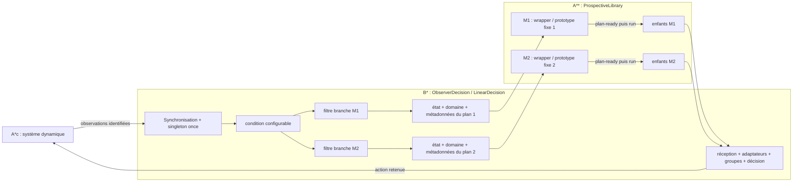

# Test 8L — Sélection dynamique de prospectifs prédéclarés

10 novembre 2026. Windows x64, MSVC/C++20, WITH_GUI=OFF. Aucun commit ni push.
Les modifications 8K présentes au début du travail sont conservées.

## Résultat et audit comparatif préalable

La solution A suffit : A** est un **couplé contenant deux wrappers fixes**.
B* choisit une branche par événements, puis lui transmet exclusivement son
état initial et son plan dynamique. Aucun changement de `simulation_wrapper`,
`embedded_simulation`, des équations QSS ou du protocole natif n'est nécessaire.
La solution B n'est pas développée. Les deux JSON livrés utilisent seulement
le catalogue existant, sans composant B*, T* ou sélecteur métier.

L'audit porte sur les rapports 8A–8K, leurs générateurs et suites, `event.hpp`,
`event.cpp`, `campaign-event.hpp`, `group-event.hpp`, `simulation.cpp`,
`error.hpp`, `native_wrapper.cpp`, `json_wrapper.hpp`, `hierarchy.hpp`, les
validateurs 8K, le catalogue, les contrats v3 et les éditeurs React Flow.

| Capacité découverte | Conséquence pour 8L |
|---|---|
| 8A–8C : opérateurs, filtres, mémoires, sélections et priorité identifiés | Une condition et une décision externe se construisent dans le graphe |
| 8D–8F : lecture native continue, maintien, `requiredInputs`, couplés réutilisables | Les observations effectives alimentent les états initiaux ; A*c/B*/A** restent distincts |
| 8G : `group_aggregate` refuse les doublons et conserve les campagnes closes | Un groupe singleton scelle une observation unique avant le routage des modèles |
| 8H : `dynamicPlan`, domaines indexés, plan/version/H/seal et plan-ready | Aucun enfant alloué à initialize ; seuls les plans scellés puis déclenchés allouent et exécutent des scénarios |
| 8I : E×q, soustraction de C0, groupement par E et contrainte/repli | La décision existante peut recevoir les résultats de la seule branche active |
| 8J : collect/isolate/fail-fast, budgets et compteurs natifs | L'inactivité d'une branche et les coûts des enfants sont vérifiables indépendamment des résultats |
| 8K : catalogue commun, prévalidation de toutes les définitions, contrôle natif avant copie et initialize | Une définition invalide bloque le document entier, même inutilisée |
| 8K : quatre surcharges `expected<void>::and_then` propagent le résultat | L'allocation, la copie des paramètres et l'initialisation ne masquent plus un échec |

`bind_wrapper` impose le lien au prototype et les dimensions avant initialize.
Chaque occurrence possède sa ressource privée. `embedded_sims_alloc` copie
le prototype de cette ressource, puis copie les paramètres et initialise les
enfants. Les références natives et identifiants de modèles restent locaux à
ces copies ; aucune topologie n'est créée pendant le calcul scientifique.
Le compilateur web refuse encore un wrapper **dans un prospectif**. Plusieurs
wrappers dans un couplé parent ne constituent pas cette imbrication interdite.

| Critère | A — composition retenue | B — collection dans un wrapper |
|---|---|---|
| Sécurité native | Protections 8H/8J/8K et copies existantes | Nouveaux invariants pour choisir une ressource, ses cibles et dimensions |
| Compatibilité | Contrat JSON et ports historiques inchangés | Extension de schéma, état natif, sérialisation, inspecteur et résultats |
| Coût | Deux prototypes privés préparés ; zéro enfant initial et seuls les enfants sélectionnés exécutés | Pourrait mutualiser certains frais ; ne dispense pas de stocker et valider les définitions |
| Campagnes | Espace commun fourni par B*, exclusivité assurée avant les deux branches ; traces distinguées par occurrence | Identité de modèle à ajouter à chaque transaction et réponse |
| Ports | Adaptation explicite du couplé, 32 ports maximum par interface | Nécessité de fixer une enveloppe commune ou de changer les ports selon le modèle |
| Construction graphique | Couplés, opérateurs et filtres déjà éditables ; graphe visible | Inspecteur et primitive nouveaux à expliquer et maintenir |

L'identité locale d'une campagne de wrapper ne devient pas automatiquement
globale. La composition fournie établit cette propriété : la même observation
identifiée traverse le singleton puis une seule branche complémentaire.
Un autre assemblage utilisateur raccordant deux wrappers à run sans cette
barrière ne possède évidemment pas cette garantie.

## Contrat de sélection et provenance

```text
Pk = (modelRef, initialState, horizon, factorDomains, selections, metadata)
modelRef = (chemin d'occurrence du wrapper, identifiant de définition)
metadata = (campagne, planId, version, contrat explicite d'interface)
```

Le graphe représente modelRef **par le routage vers une occurrence fixe**,
pas par une référence mutable de prototype. `forecast/M1` et `forecast/M2`
désignent des ressources différentes. Les événements `identity0`/`identity1`
portent en plus les labels graphiques 1/2, reçus par `selectedModel` ; ces
labels locaux ne remplacent pas le chemin de provenance natif. Les chaînes
de définitions ne transitent pas dans les messages DEVS à trois réels.

| Champ | Déclaration et preuve effective |
|---|---|
| Identité du modèle | Occurrence de wrapper + `experiment.definition`, avant exécution |
| Identité/version du plan | Champs 0/1 de dynamicPlan ; traces natives `PLAN` de la trame réellement scellée |
| Campagne | Troisième réel, 1 puis 2 ; conservé dans les facteurs, critères, statuts et réponses différées |
| États initiaux | Tous les facteurs `single` sont `requiredInputs`, sans héritage des sentinelles |
| Facteurs/domaines | Cibles et paramètres validés, domaines `fixed` transmis avec indices et cardinalités |
| Horizon | Champ 2, strictement positif et borné par le prototype ; sortie native par enfant |
| Indicateurs | Sélections explicites, avec cible et réduction ; nom d'interface descriptif dans le JSON |
| Correspondance | Connexions explicites des ports du couplé et adaptateurs de critères construits dans B* |
| Validation | Précontrôles JSON/natifs avant initialize ; contrôles dynamiques au scellement |
| Modèle exécuté | Source `component` de chaque événement, paramètres réels des enfants et banc `RESOURCE`/`CHILD` |

Le contrat ne dépend pas de N, C, E ou q. Le même assemblage est utilisé avec
X et u. Il n'infère aucune équivalence sémantique de noms identiques. Les
facteurs et critères des deux démonstrateurs partagent ici, **par déclaration
de leur construction**, les mêmes grandeurs et unités. Les noms descriptifs
ne sont pas un système de preuve dimensionnelle automatique.

Chaque preuve JSON garde la requête complète avec les définitions et leurs
paramètres, et la réponse brute. Les preuves accompagnées du banc natif
contiennent aussi `scientificReport` : définition, campagne, plan/version
réellement scellés, scénario, facteurs appliqués, horizon, critères présents
ou absents, statut, appels enfant/campagne et limites configurées. Ce rapport
est une jointure de données natives, sans calcul scientifique de substitution.
Une sortie historical sans numéro de campagne n'est pas utilisée pour cette
jointure. Les deux wrappers sont configurés en `resultMode=collect`.

Les identités 1/2 des campagnes sont communes aux deux branches **dans une
exécution de B***. Une nouvelle exécution ou un reset recommence cet espace
d'identification. L'archivage conserve donc aussi le contexte d'exécution :
requête complète, `httpRunId`/`httpRequestId` dans les captures HTTP, dossier
de preuve et numéro de passage du banc. Il ne faut pas concaténer des résultats
de plusieurs runs en utilisant le seul numéro de campagne.

## Graphe exécutable et transactions



Le singleton est un `group_aggregate` min avec required=1, endCount=0,
clé 0 et cardinalité 1. Il rend l'observation d'origine, sans la modifier.
Son registre de clôture rejette sa répétition, y compris après vidage de la
FIFO. Le comparateur `< seuil` et son complément activent des filtres distincts.
La fonction de sélection du modèle, les payloads des domaines et la sélection
finale de l'action sont trois sous-graphes distincts.

`BuildPlan` reçoit les deux sorties de sélection, avec des payloads séparés
et éditables par branche. Les atomes des deux plans sont partagés dans une
même définition, sans dupliquer le planificateur entier. Cette factorisation
est nécessaire pour garder les 119 atomes du parent Schaefer sous la limite
128 existante. La première tentative avec deux planificateurs dépassait ce
plafond et a été abandonnée, sans relever une limite.

Chaque wrapper émet son propre plan-ready ; des opérateurs ordinaires dans
A** répondent par run avec la **même campagne**. Le délai nominal est zéro.
Les micro-transitions DEVS restent à t=1 ou t=3 ; aucun epsilon n'est ajouté.
Une branche non sélectionnée ne reçoit ni état, ni domaine, ni seal, ni run.
La fusion des sorties scientifiques dans le couplé est sûre parce que les
campagnes sont exclusives et que leurs identités restent intactes. Les sorties
natives restent, elles, attribuées à leur occurrence de wrapper distincte.

Les doublons identiques ou contradictoires d'observation et les sélections
tardives sont des erreurs natives de protocole (3/70). Une définition absente
ou inconnue est rejetée avant allocation scientifique. Il n'existe pas de port
acceptant une chaîne arbitraire de prototype inconnue : l'ensemble sélectionnable
est celui des références câblées et prévalidées. Des identités de modèles
contradictoires pour une même campagne ne peuvent donc pas ouvrir deux plans
dans ce graphe : elles nécessiteraient une deuxième observation refusée par once.

Un nouveau plan incomplet ne réutilise jamais les enfants d'un ancien plan.
Le scellement refuse les absences ; sans observation, aucune branche ne démarre.
Cancel ferme le plan et interdit son run ultérieur. L'annulation d'une réponse
différée reste locale à son wrapper ; elle n'annule pas la réponse de l'autre.
Deux campagnes sur deux modèles peuvent se chevaucher avec des réponses à
t=5 et t=7 pour un délai explicite 4. Le banc réinitialise **le même graphe**
deux fois et compare exactement événements, sacs et paramètres. Un troisième
cycle réutilise M1 après M2 avec un nouvel état initial réel transmis.

## Interfaces et démonstrateur minimal

Fichier : `web/examples/decision-select-prospect-model-v3.json`.
M1 contient deux atomes : intégrateur QSS3 X et constante u, avec dX/dt=u.
M2 contient cinq atomes : les précédents plus lambda, un multiplicateur et
une somme pondérée, avec dX/dt=u−lambda X. lambda=0.5, configurable dans la
définition avant exécution ; dQ=0.001. Les topologies et nombres d'atomes
diffèrent réellement.

Interface déclarée : X0, u, horizon H, X(H), avec une échelle de temps commune
et une grandeur X dimensionnelle conventionnellement égale à 1. Le critère
`max-last` lit l'intégrateur du prospectif exécuté. B* soustrait la cible
configurable 2, prend la valeur absolue, la multiplie par −1 et maximise ce
score en associant le vrai u au même scénario. Aucun oracle n'est dans le graphe.

Le document principal utilise le Plant dynamique dX/dt=u(t), X(0)=−1 et
u(0)=0. Les lectures à 1 et 3 produisent −1 puis 1. La variante de test
`controlled:true` remplace seulement ces entrées par les stimuli connus −1/1 ;
elle est séparée et explicitement documentée, jamais utilisée comme preuve
principale de la rétroaction.

| Campagne | Modèle | X0 | Domaine u | H | X(H) natifs | Appels enfant |
|---|---|---:|---|---:|---|---|
| 1 à t=1 | LinearProspect / M1 | −1 | −1,0,1 | 2 | −3,−1,1 | 4,3,4 |
| 2 à t=3 | DampedProspect / M2 | 1 | −1,0 | 1 | −0.180470697657306, 0.606480181876945 | 37,31 |

Oracles indépendants : M1=X0+uH ;
M2=X0 exp(−lambda H)+(u/lambda)(1−exp(−lambda H)). Pour la campagne 2,
les valeurs analytiques sont −0.180408020862100 et 0.606530659712633.
Tolérance terminale 0.002 ; modifier lambda à 1 vérifie réellement les
nouvelles valeurs. Les actions sont u=1 à t=1 puis u=0 à t=3 ; le Plant
termine avec X=1. Aucun scénario M2 n'est exécuté pour la campagne 1,
ni aucun scénario M1 pour la campagne 2.

## Démonstrateur Schaefer, décisions et trajectoire

Fichier : `web/examples/tstar-schaefer-select-prospect-v3.json`.
Le Plant 8I/8J reste identique : N0=150, C0=0, E0=260, r=.35, K=300,
a=1, q=.001, dQ=.01. Temps parent [0,5], décisions à 1 et 3.

M1 est le prototype Schaefer standard 8I, 15 atomes. M2 le copie, conserve
dC/dt=q a E N et ajoute −mN à dN/dt par une constante m=.08, un multiplicateur
et une somme QSS3, soit 18 atomes. Le JSON ne contient aucune primitive nouvelle
pour cette équation. **M2 est un instrument de vérification de l'architecture,
pas un modèle biologique calibré du lac de Guiers.**

Contrat commun explicite : états initiaux N0/C0 ; action E ; hypothèse q ;
critères min N et C(H). Le récepteur calcule DeltaC=C(H)−C0, puis regroupe par
E, réduit min DeltaC et min N sur les q de cette action, impose Nrob>=140,
maximise la capture admissible, sinon maximise Nrob avec départage par capture.
La priorité et le départage proviennent des composants génériques existants.

| Campagne | N/C réellement observés | Modèle | Plan/version | E | q | H | Scénarios/appels |
|---|---|---|---|---|---|---:|---|
| 1, t=1 | 138.722797477662 / 37.474201388035 | forecast/M1, SchaeferProspect | 1/1 | 80,150,260 | .0008,.001 | 20 | 6 / 1486 |
| 2, t=3 | 148.032956366218 / 80.549582911628 | forecast/M2, SchaeferMortality | 2/1 | 80,150 | .0008,.001 | 10 | 4 / 672 |

Les observations réelles traversent N<140 puis son complément ; aucune variante
contrôlée n'est nécessaire pour faire changer le modèle dans cette boucle.
Les domaines et horizons appartiennent au plan de la branche choisie.
Premier facteur le plus rapide : E varie avant q ; les scénarios 0/3,1/4,2/5
de la campagne 1 appartiennent respectivement aux groupes E=80,150,260.

| Campagne/scénario | Modèle | E | q | min N natif | C(H) natif | Appels |
|---|---|---:|---:|---:|---:|---:|
| 1/0 | M1 | 80 | .0008 | 138.722797478 | 319.944905667 | 308 |
| 1/1 | M1 | 150 | .0008 | 138.722797478 | 474.839064801 | 248 |
| 1/2 | M1 | 260 | .0008 | 122.591960082 | 565.838984697 | 172 |
| 1/3 | M1 | 80 | .001 | 138.722797478 | 372.695377104 | 295 |
| 1/4 | M1 | 150 | .001 | 138.722797478 | 525.092425402 | 222 |
| 1/5 | M1 | 260 | .001 | 83.248187791 | 552.393434572 | 241 |
| 2/0 | M2 | 80 | .0008 | 148.032956366 | 185.214744536 | 178 |
| 2/1 | M2 | 150 | .0008 | 132.455513807 | 246.269695996 | 150 |
| 2/2 | M2 | 80 | .001 | 148.032956366 | 205.309291387 | 149 |
| 2/3 | M2 | 150 | .001 | 113.265082610 | 269.248304327 | 195 |

Pour les références indépendantes, alpha=r−qE−m, beta=r/K et
D=1+beta N0 expm1(alpha H)/alpha, avec sa limite H si alpha=0.
Alors N(H)=N0 exp(alpha H)/D et C(H)=C0+qE log(D)/beta.
Cette solution analytique est extérieure au simulateur et valable pour les
deux équations de vérification. min N est min(N0,N(H)) sur ces trajectoires.

Les comparaisons portent sur tous les critères de tous les scénarios et sur
tous les points de la trajectoire parent, avec les tolérances 8I : N parent
0.05, C parent 0.10, critères N 0.06 et C 0.30. Les facteurs des enfants sont
comparés aux observations analytiques et aux domaines exacts ; les compteurs
proviennent des appels natifs réels.

À t=1, les groupes E=80 et E=150 ont la même biomasse minimale initiale,
inférieure à 140. Le repli les départage par capture et choisit **150**.
À t=3, avec M2, E=150 a une biomasse robuste proche de 113.27, tandis que
E=80 conserve environ 148.03 : la contrainte choisit **80**. La mortalité
prospective n'est jamais appliquée au Plant standard ; c'est le changement
d'action qui modifie sa trajectoire.

| Valeur finale du Plant | QSS natif | Oracle indépendant |
|---|---:|---:|
| N(5) | 174.227245074572 | 174.230760351182 |
| C(5) | 106.405070064056 | 106.406133908139 |

La référence 8I nominale E=150/150 terminait à N≈155.0071 et C≈126.0584.
Elle n'a pas été réutilisée comme résultat attendu de 8L. Les dates et actions
exactes viennent de `plant/effort:0` dans les sacs natifs : (0,260), (1,150),
(3,80). Le temps d'une observation discrète rééchantillonnée n'est pas utilisé
pour déterminer la date native d'une commande.

## Validation structurelle, erreurs et budgets

Tous les prototypes, dépendances, références, paramètres, ports, cibles de
facteurs et critères passent les validations 8K **avant** initialize. Un modèle
invalide dans une branche jamais sélectionnée, ou une définition totalement
inutilisée, bloque l'intégralité du document ; il n'est pas toléré en attente
d'une sélection future. Le rejet natif est également vérifié sans frontend.
La correction `expected<void>::and_then` est conservée dans les chaînes
d'allocation/copie/initialisation et son banc de régression 8K est rejoué.

L'adaptation de critères est une construction explicite : débrancher le critère
de l'adaptateur requis ne produit ni score ni nouvelle action. Une référence
ou connexion vers une interface inexistante est rejetée structurellement.
Un critère de même nom dans une autre définition n'est jamais automatiquement
raccordé ou comparé. Une correspondance d'unités différente demanderait un
adaptateur utilisateur explicite ; le moteur ne dispose pas d'ontologie
scientifique ou de validation universelle des unités.

Les plafonds restent 10000 appels par enfant et 100000 par campagne dans les
documents nominaux. Les essais abaissent réellement les limites à 1 : aucun
critère fictif n'est produit ; les autres enfants peuvent être annulés avant
leur premier appel. Une puissance QSS3 d'exposant 2000 dans M2, alimentée par
.5/2, est structurellement valide : isolate rend un succès et un numérique
invalide ; fail-fast rend l'erreur native 3/67. Collect laisse la décision à
B*. Les erreurs de protocole et de structure ne sont pas récupérées par isolate.

Le banc C++ `model-selection-native` inspecte, avant toute sérialisation :
les trames scellées, les paramètres enfants, le modèle source, la taille des
simulations, leurs issues, les appels et l'horizon. À chaque sac, il vérifie
qu'une branche qui ne vient pas de recevoir sa campagne ne change ni son nombre
d'enfants ni ses compteurs. Il refuse une exécution précédant la sélection.
`NON_SELECTED ... new_children=0 run_calls=0 events=0` ne signifie pas effacer
les enfants d'une campagne ancienne : ils peuvent rester stockés, sans nouvel
appel. Les enfants initiaux sont bien absents des deux branches dynamicPlan.

Le parent minimal compte 63 atomes et 97 connexions développées, auxquels
s'ajoutent 20 récepteurs privés de collecte. Le parent Schaefer compte 119
atomes, 255 connexions et 22 récepteurs privés. Avec les copies de descripteurs,
prototypes privés, capacités maximales déclarées et récepteurs conservateurs,
le calcul de budget natif/v3 donne respectivement 133/456 modèles, 161/655
connexions et 132/4848 points internes potentiels. Ces bornes comprennent les
deux modèles déclarés ; elles ne signifient pas que les deux campagnes sont
calculées dans les deux branches. Aucun gain de temps CPU n'est déduit de ces
compteurs ; aucun plafond de production n'est relevé.

## React Flow et fichiers reproductibles

L'utilisateur peut créer/ouvrir les définitions, éditer leurs constantes et
équations QSS, ajouter une interface explicite, construire la condition avec
des opérateurs génériques, modifier le seuil, remplacer les prototypes déclarés
dans les inspecteurs de wrappers, éditer les payloads/domaines/horizons et
consulter les événements avec le chemin du wrapper exécuté.

La correction frontend unique aligne l'éditeur d'interfaces sur le schéma
déjà existant : indices 0–31 au lieu du plafond artificiel 15. Aucun plafond
JSON/natif n'est relevé. Aucune logique de sélection scientifique n'est exécutée
dans React ; le navigateur édite, transmet et affiche les données du moteur.

Les parcours 8L construisent un couplé `UiModelCondition` depuis des atomes,
remplacent le comparateur dans SelectProspective et recâblent les sorties.
Seuil 2 : M1 seul ; seuil 0 : M1 puis M2. Un autre parcours modifie m dans la
composition QSS de M2 et vérifie le changement de ses vrais critères. Export,
nouveau document, réimport et nouvelle exécution restituent exactement les
événements et observations. Le test d'interface ajoute puis retire le port 23.

Génération : `node web/engine/runner/decision-8l-fixture.mjs --write`.
Suite ciblée : `npm run test:decision-8l` dans web, avec IRRITATOR_RUNNER.
DECISION_8L_HTTP=1 active le vrai serveur Fastify ; IRRITATOR_8L_EVIDENCE garde
les requêtes, réponses, rapports et traces C++.

## Campagnes de validation et incidents conservés

Les campagnes finales utilisent Node 24.22.1 et les mêmes sources en Release
et Debug. Les runners et bancs 8L sont construits dans
`build-web-test8l/{Release,Debug}/runner`. Les bibliothèques scientifiques et
les bancs historiques, sans modification 8L, sont reconfigurés et reconstruits
incrémentalement dans `build-web-test8k/{Release,Debug}/{engine,historical}`.

| Validation finale | Release | Debug |
|---|---:|---:|
| CTest runner, JSON et bancs natifs | 56 réussis / 59 | 56 réussis / 59 après reprise 7F |
| Tests officiels du moteur | 10/10 | 10/10 |
| Stabilisation du wrapper historique | 40/40 | 40/40 |
| API Fastify | 96/96 | 96/96 |
| HTTP réel 8B, 8C, 8D, 8E, 8F, 8G | 12, 13, 13, 23, 20, 11 | identique, tous réussis |
| HTTP réel 8H, 8I, 8J, 8K, 8L | 19, 17, 18, 22, 17 | identique, tous réussis |
| Flux de diagnostic | 2/2 | 2/2 |
| Playwright, tous les parcours React Flow | 80/80 | 80/80 |
| Comparaison stdout complète avec le runner 8K | 43/43 identiques | 43/43 identiques |

Vitest réussit **177/177 tests dans 17 fichiers**. La construction de production
Next et la vérification TypeScript réussissent aussi. Les comparaisons 8K/8L
portent sur les 43 exemples valides, dont les deux nouveaux modèles composés :
le runner antérieur savait déjà les exécuter sans extension du moteur.

Les trois échecs CTest persistants sont `runner-wrapper-7g`,
`native-wrapper-schaefer-trajectories` et `native-wrapper-schaefer-pair`.
Ils dépendent du fichier `web/model-test/modelhalieutiquetest-points.csv`
absent, qui reste absent : aucune reconstruction, substitution ou skip.
CTest garde son code de sortie 8 et les scripts de campagne leur sortie non
nulle ; le bilan ci-dessus ne transforme pas ces échecs en succès.

Le passage Debug initial obtient 55/59 : `runner-wrapper-7f` dépasse en plus
son délai de 120 secondes sous la charge des validations concurrentes.
Sa reprise isolée réussit en 106.75 secondes, sans modifier ce délai, le test
ou les sources. `runner-retries.xml` conserve cette reprise séparément du
`runner.xml` initial ; le bilan consolidé compte chaque test une seule fois.

Index des preuves finales, chemins relatifs à la racine du dépôt :

- Release : `build-web-test8l/Release/logs/run-20261110-133251-5747201-42468`.
- Debug : `build-web-test8l/Debug/logs/run-20261110-133302-6913870-19444`.
- Navigateur Release : `build-web-test8l/playwright-release-20261110-133354-0368605-9104`.
- Navigateur Debug : `build-web-test8l/playwright-debug-20261110-133354-6320886-29088`.
- Runtime : `build-web-test8l/runtime-node24.json` ; Vitest et construction :
  `build-web-test8l/audit/vitest-node24.log` et `frontend-build-node24.log`.
- Comparaisons : `build-web-test8l/comparison-release-node24/summary.json`
  et `build-web-test8l/comparison-debug-node24/summary.json`.
- Vérification croisée : `build-web-test8l/final-validation.json`.
- Empreintes SHA-256 des livrables, sources 8L et exécutables :
  `build-web-test8l/delivery-manifest.json`.

Chaque racine native contient les XML CTest, les journaux API/HTTP, les codes
de sortie et les captures dans `http-8b` à `http-8l`. Les traces `*-native.log`
et les rapports `scientific-results.json` de `http-8l` donnent les facteurs,
les résultats, les appels et les actions effectivement observés. Les racines
navigateur gardent `result.json`, `run.log`, les requêtes/réponses et les
captures graphiques, notamment dans `8l`.

Le vérificateur `web/engine/runner/tests-wrapper/verify-8l.mjs` compare
**411 paires requête/résultat et 34 captures de processus** entre les deux
configurations. Il exige aussi l'égalité des rapports scientifiques et des
traces natives 8L, les resets réussis, le runtime Node 24 effectivement mis
en cache par CMake, les 80 parcours réussis par navigateur et l'absence du CSV.
Résultat : `8L_EVIDENCE_VERIFIED 411 34`.

Pour reproduire la campagne native/JSON/HTTP :

```powershell
./web/engine/runner/tests-wrapper/run-8l.ps1 -Configuration Release
./web/engine/runner/tests-wrapper/run-8l.ps1 -Configuration Debug
```

Le script `browser-8l.ps1 -Configuration Release|Debug -FrontendUrl URL`
relance les parcours sur le frontend et l'API correspondant à la configuration.
Chaque invocation crée un dossier horodaté ; elle n'écrase pas les essais
précédents. Les preuves de cette campagne restent locales, sans commit ni push.
Le contrôle final `git diff --check` réussit. Le fichier de diagnostic généré
`irt-mem.txt`, initialement propre, est rétabli à son contenu de départ après
les tests ; les modifications 8K préexistantes restent présentes.

Incidents initiaux conservés sous `build-web-test8l/audit` et
`Release/targeted-initial` : ports descriptifs ne respectant pas le schéma des
noms, interfaces devenues sans endpoint après extraction de run, observation
du comparateur déplacé, et dépassement du nombre d'atomes avec deux planners.
Les exemples ont été corrigés par composition et factorisation.
Le premier passage ciblé obtient 16/17 : l'oracle indépendant de décision
omettait le départage par capture quand deux minima de biomasse sont égaux.
La correction de cet oracle, sans modification des équations ni des sorties
natives, retrouve l'action 150 et toutes les comparaisons Schaefer.

La reconstruction du banc de provenance enrichi rencontre deux C1060 (heap
de l'optimiseur MSVC). Les journaux `native-provenance-build.log` et
`native-provenance-build-retry.log` restent conservés. Le banc d'inspection
seul est compilé avec /Od ; les paramètres du moteur lié et du runner Release
restent ceux de Release. La reprise `native-provenance-build-od.log` réussit.
Il ne s'agit pas d'un benchmark de performance du banc ; les valeurs et coûts
en appels du solveur lié ne changent pas.

Les premières commandes utilisaient le Node 26 système, hors de la plage
déclarée par web/package.json. Elles sont conservées comme essais initiaux.
La validation finale est reprise avec Node 24.22.1. Les scripts 8L choisissent
un Node 24 disponible sur PATH et fixent également `NODE_EXECUTABLE` dans le
cache CMake : changer seulement PATH ne remplaçait pas l'exécutable 26 déjà
mémorisé par CTest. Le navigateur est lancé directement avec ce Node, sans
passer par un npx système susceptible de relancer Node 26. Vitest et Next sont
également rejoués avec Node 24 ; ni les binaires scientifiques, ni les budgets,
ni les tests attendus ne sont modifiés pour ces reprises.

Les essais initiaux incluent deux sorties de processus vides dans les suites
contract/v3 et un handshake navigateur RUNNER_INCOMPATIBLE, puis un état
déconnecté. Les captures et journaux restent séparés. Dix répétitions du rejet
dQ=0 sur les runners 8K/8L rendent toutes l'enveloppe correcte ; les reprises
CTest et des deux parcours navigateur passent avant même le changement de
Node. La cause des sorties vides n'est pas établie ; elle n'est pas attribuée
à une règle scientifique ni masquée par une récupération du processus.

## Limites

- Collection déclarée finie et topologies fixes ; aucune modification du
  prototype d'un wrapper pendant l'exécution, ni création arbitraire de graphe.
- Des ports et tableaux d'interface explicites restent nécessaires entre des
  wrappers ayant des dimensions différentes ; l'exemple utilise les mêmes
  dimensions scientifiques, avec des topologies différentes.
- Deux prototypes préparés et les états de routage ont un coût mémoire, même
  si un modèle ne simule aucun scénario. Le catalogue limite les wrappers à 8,
  les atomes parent à 128, et les files/identités aux capacités natives.
- La fusion des campagnes dépend du contrat d'exclusivité construit dans B* ;
  brancher arbitrairement les commandes de deux wrappers n'est pas un sélecteur sûr.
- Les correspondances scientifiques sont déclarées par les interfaces et
  connexions ; aucune équivalence d'unités ou de sens n'est déduite des noms.
- Les limites 8J/8K restent actives : calcul enfant synchrone, un niveau de
  wrappers prospectifs web, absence de reprise après erreur native non récupérable.
- La règle de sélection configurable démontre une capacité architecturale ;
  elle ne prouve pas que le modèle choisi est le plus fidèle au système réel.
