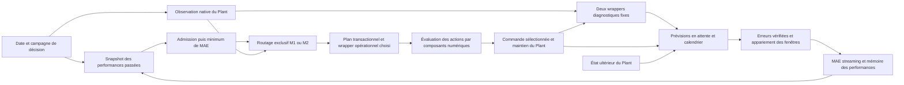

# Test 8N — Sélection adaptative sur performances prédictives vérifiées

10 novembre 2026, Windows x64, MSVC/C++20, Node 24.22.1. Aucun commit ni push.

## Résultat et fichiers

La sélection prospective est une composition d'atomes DEVS existants. Aucun
changement de primitive, de solveur QSS, de bibliothèque scientifique, de plafond
de ressources ou de code applicatif de décision n'est nécessaire.

Documents scientifiques v3 importables dans Irritator :

- `web/examples/decision-adaptive-prospect-selection-v3.json` : Plant intégrateur,
  diagnostic apparié M1/M2, démarrage M2, puis minimisation de MAE.
- `web/examples/decision-adaptive-prospect-baseline-v3.json` : référence fixe M2,
  avec les mêmes équations, dates, cible, domaines et diagnostics.
- `web/examples/decision-adaptive-prospect-alternative-plant-v3.json` : même
  sélecteur, Plant amorti correspondant à M2.
- `web/examples/tstar-schaefer-adaptive-prospect-v3.json` : vérification de
  biomasse sur [3,4], utilisée à la décision suivante de t=5.

Le générateur `web/engine/runner/decision-8n-fixture.mjs` décrit des graphes ; il
ne lit aucun résultat pour choisir un modèle ou une action. Les équations
analytiques sont exclusivement dans les tests. Les quatre JSON sont autonomes
et n'ont pas besoin du générateur pendant leur exécution.

## Audit 8A–8M et décision de réutilisation

L'audit porte sur les rapports 8A à 8M, les générateurs et exemples 8H/8L/8M,
`lib/src/event.cpp`, `campaign-event.hpp`, `event.hpp`, les tests natifs de
mémoires, copies/snapshots et rapprochements, les contrats/catalogues et les
parcours React Flow. Les trois démonstrateurs 8M restent inchangés.

| Mécanisme | Fonction réutilisée et restriction conservée |
|---|---|
| 8A, `event_tag` | Réétiquetage explicite ; clés exactes, locales au graphe/reset |
| 8A, `value_memory` | Écritures puis lectures confluentes, table par (identité,campagne), sortie missing distincte ; aucun accès implicite à une autre campagne |
| `event_operator` | Jointures, distance à cible, AE, admission et conditions de routage ; non-finis sur sortie invalid |
| `outputIdentity` 8M | Identités des modèles et des champs du plan explicites, sans perdre la campagne |
| `candidate_filter` | Champs requis, filtrage avant clôture et compte des seuls candidats transmis |
| `candidate_select` | Minimisation, action associée, départage exact par identité, statut et repli configurables |
| `selection_priority` 8C | Disponible pour un repli sur une autre sélection réelle ; inutile pour le démarrage constant explicitement choisi ici |
| 8D/8E, `state_observer` | État continu natif à la demande, et non dernier point d'une courbe |
| 8D, `zero_order_hold` | Action réellement appliquée au Plant ; source du garde de contexte |
| 8G, `group_aggregate` | Protection de l'unicité d'une décision par campagne ; groupement opérationnel Schaefer conservé |
| 8H | Plans complets, domaines indexés, seal/ready/run et facteurs obligatoires ; aucun enfant opérationnel sur une branche non choisie |
| 8I | Conservation des sous-fonctions observation, réception, agrégation et décision de la triade Schaefer |
| 8J | Mode collect, isolation et budgets natifs des enfants, statuts non numériques distincts des critères |
| 8K | Validation des références, interfaces et sources avant l'exécution, y compris les prototypes non activés |
| 8L, `ProspectiveLibrary` | Deux occurrences fixes ; seuls état, contexte et plan de la branche choisie sont transmis |
| 8M, `event_calendar` | Dates réelles de vérification, identités, annulation et saturation explicites |
| 8M, `temporal_pair` | Prévision/observation de même fenêtre, statut de simulation, horizon effectif et constance de commande |
| 8M, streaming | Erreurs originales conservées par fenêtre ; moyenne et compte réémis après chaque nouvelle ligne admise |
| Copies/snapshots | `event_states` possédés par la simulation ; tests natifs de copie profonde et réinitialisation réutilisés |

Le problème de lecture intercampagnes ne justifie pas de primitive nouvelle.
Il se résout avec des tags et des mémoires existants, en conservant séparément
l'identité historique et l'identité de la campagne qui demande la sélection.

## Les trois boucles et leurs connexions



La boucle opérationnelle n'exécute que le wrapper retenu. La boucle
diagnostique exécute intentionnellement les deux modèles, sur le même état
observé, la même action choisie et le même horizon. Elle ne change pas une
action déjà appliquée. La boucle d'adaptation lit les performances au début
d'une nouvelle campagne ; ses résultats commandent le routage opérationnel.

`once` protège chaque observation décisionnelle contre les rejouements.
Les filtres `M1route0/1` et `M2route0/1` attendent à la fois l'état/contexte,
la condition issue de `selected` et la clôture singleton. L'acquittement
plan-ready de la seule branche alimentée déclenche son run. Il n'y a pas de
remplacement de topologie pendant une simulation.

## Historique, provenance et lecture décisionnelle

Une fenêtre conserve sa clé native `(occurrence temporal_pair, scénario,
campagne diagnostique)`. Le wrapper, sa définition, le plan et les facteurs
effectivement exécutés restent dans la requête, les événements de résultat
et les historiques natifs. Le scénario diagnostique est 0 ; les identités de
modèles 1/2 sont des identités d'un autre flux, pas des scénarios opérationnels.

Avant agrégation, deux opérateurs `M1Xpaired/M2Xpaired` (ou `M1Npaired/M2Npaired`)
exigent les deux AE sous la même clé, `required=3`. Chacun transmet sa propre
valeur lorsque les deux sont présentes. Une fenêtre valide d'un seul modèle
reste archivée dans AE/temporal_pair mais n'entre dans aucune des deux MAE
comparées. Les deux comptes progressent donc ensemble : un seul registre de
compte apparié est nécessaire. Les deux sorties natives de compte restent
observables et sont contrôlées par les tests.

Dans `SelectProspective`, les pertes et le compte ont un registre de dernière
valeur à clé volontairement normalisée `(0,0)`. Ce registre remplaçable n'est
pas présenté comme un historique immuable. Les erreurs et leurs campagnes
originales restent dans les agrégats streaming, les rapprochements et la trace.
À une nouvelle décision, `readHistory` demande cette clé. Les tags `M1lossRead`,
`M2lossRead`, `M1countRead`, `M2countRead` construisent les candidats de la
**nouvelle** campagne. Le payload du déclencheur porte explicitement ce numéro,
égal à celui du tag de campagne. Ce contrat doit être maintenu en ajoutant une
date de décision.

Une valeur initiale de registre n'est jamais une observation : le compte
initial est 0 et la condition `count >= n_min` interdit son admission. Dans
le graphe livré, une MAE ne peut progresser qu'après réception de deux erreurs
finies et appariées. Déplacer une transformation métrique exige de conserver
cette barrière de validité ; une sortie `invalid` n'est pas une valeur d'erreur.

Chaque sélection est reconstructible avec :

1. L'événement `observer/selector/selected=[modèle,0,nouvelle campagne]`.
2. Les pertes, comptes et conditions relus sous cette campagne.
3. Les événements MAE et les fenêtres vérifiées ayant alimenté les registres,
   avec leurs dates/bags et leurs anciennes campagnes.
4. Le chemin `forecast/M1` ou `forecast/M2`, sa définition scientifique,
   les paramètres de son expérience, les champs du plan transmis et les
   événements plan-ready.
5. Les scénarios, facteurs, horizons, critères, statuts et coûts réellement émis.
6. L'action native de la décision et la sortie du maintien du Plant.

`tests-wrapper/verify-8n.mjs` projette ces preuves et compare les résultats
Release/Debug. Il ne recalcule jamais le meilleur modèle. Les captures HTTP
conservent également runId/requestId ; un nouveau reset est un nouvel espace
local, pas la continuation implicite d'une campagne antérieure.
Des copies d'audit observent les sorties natives de `BuildPlan` : identifiant,
version, horizon, scellement, cardinalités et domaines. Le vérificateur exige
le même plan-ready et les mêmes résultats, modèles et commandes que dans les
documents livrés. Aucun champ de plan n'est envoyé par une branche non retenue.
Les cinq expériences ont des plans version 1 : plan 2 sur M2 et plan 1 sur M1.

Les chaînes de provenance, unités et cohortes restent dans `forecastContracts`
et dans les chemins de composants. Elles ne sont pas encodées dans des doubles.
Comme en 8M, le moteur ne déduit pas une équivalence scientifique d'unités ou
de cohortes à partir de leurs noms. Le câblage de l'appariement matérialise le
contrat ; une déclaration sémantique incohérente n'est pas automatiquement prouvée
correcte par le moteur.

## Admission, démarrage, départage et stabilité

Pour la cohorte configurée, soit W(tk) l'ensemble des fenêtres appariées dont
les évaluations sont vérifiées et publiées avant le snapshot de tk. Pour
chaque modèle i, `L_i(tk)=sum(AE_i(w), w dans W(tk))/|W(tk)|`. Si cet ensemble
est vide, L_i est absent. L'admission exige notamment `|W(tk)| >= n_min`, et
le modèle choisi minimise L_i parmi les admis. La date de disponibilité est
celle de l'événement natif publié dans la mémoire ; sa date historique reste
dans la trace, distincte de la date du snapshot relu.

Les deux modèles prédisent la même variable/unité, avec H=1, et sont vérifiés
sur les mêmes fenêtres. Une instance de streaming correspond à une cohorte
déclarée de lois et paramètres fixes. Les états et commandes propres à chaque
fenêtre restent enregistrés ; on n'agrège ni unités différentes ni runs.

`M1admissible` et `M2admissible` sont des comparateurs numériques éditables.
Leurs paramètres `right=1` constituent le n_min principal. Le filtre exige
score, action-identité et condition (`required=7`). Le sélecteur minimise
(`direction=1`) et départage deux pertes exactement égales par la plus petite
identité locale. Le repli initial M2 est `chooseModel.fallback=2`, visible dans
le graphe. `emitFallback=0` supprime une nouvelle sélection si l'ensemble admis
est vide. La variante fixe conserve ce même graphe et configure les seuils
au-delà de sa capacité de stockage ; elle applique ainsi explicitement M2 à
chaque décision, sans modifier ses équations ou son domaine d'action.

Les variantes n_min=2 et 3 déclarent non admissible un modèle dont le compte
est inférieur au seuil. Avec deux fenêtres vérifiées à t=4, n_min=2 peut prendre
le relais à t=5 ; n_min=3 garde le repli. **n_min=1, et même ces deux ou trois
fenêtres, ne démontrent pas une qualité statistique robuste.**
Le test poursuit aussi une troisième fenêtre : à t=7, ses trois vérifications
passées permettent enfin l'admission pour n_min=3.

L'option de construction `delta` ajoute uniquement des opérateurs et une mémoire
de l'identité précédente. Elle minimise `MAE - delta * indicatrice(incumbent)`
et utilise l'indicatrice comme critère secondaire favorisant le modèle courant
en cas d'égalité ajustée. Le changement exige donc une amélioration strictement
supérieure à delta. Les tests couvrent delta=0, .1 et .3, ainsi que l'égalité.
Ce coût est une règle scientifique optionnelle éditable, distincte de
`event_operator.epsilon`, qui reste nul. Il ne représente pas une incertitude
statistique établie. Aucun choix d'hystérésis n'est imposé au moteur.

## Causalité temporelle

Une simulation enfant terminée à t=1 ne constitue pas une évaluation empirique.
Les prévisions restent dans temporal_pair jusqu'à l'observation à t=2. Les AE,
MAE et comptes n'apparaissent qu'à cette date, après les micro-transitions de
lecture, rapprochement et calcul. La décision t=1 n'y a pas accès. La décision
t=3 lit le registre publié à t=2, sans réétiqueter cet événement historique.

Le graphe définit un point de snapshot au déclenchement de la décision, avant
la demande d'état et avant tout diagnostic de cette nouvelle campagne. Si une
observation coïncide avec ce déclenchement, la lecture du registre précède les
micro-transitions observation → temporal_pair → erreur → AE → appariement →
MAE → publication dans ce graphe. Cette observation **ne participe pas** à cette
décision. Le test déplace la seconde décision à t=2 et vérifie au même temps
logique `snapshot.bag < publication.bag`, avec compte relu nul. Il n'y a ni
epsilon de temps ni réécriture rétroactive.

Cette convention est celle du câblage livré, pas une règle universelle de
confluence ajoutée au moteur. Une autre composition choisissant d'inclure un
résultat au même instant doit établir explicitement sa frontière et son ordre
causal ; les écritures/lectures du même sac de value_memory voient l'écriture.
Les expériences principales séparent volontairement t=2 et t=3.

Une variante retarde la publication des métriques de 1.5 au moyen d'un second
calendrier natif et de mémoires identifiées. La vérification reste à t=2, la
publication intervient à t=3.5 : la décision t=3 garde M2, celle de t=5 peut
utiliser cette seule première fenêtre. Les fenêtres plus récentes non publiées
ne sont pas inventées. Des campagnes diagnostiques chevauchantes restent
en attente jusqu'à leurs propres échéances.

Une variation de commande strictement intérieure à une fenêtre constante reçoit
le statut 6 et ne participe à aucune MAE appariée. Une annulation avant
vérification reçoit 7. Les résultats déjà clos suivent l'anti-rejeu 8M ; cette
expérience n'ajoute pas un protocole de rétractation rétroactive de statistiques
déjà publiées. Changer de cohorte/régime impose un autre sous-graphe ou un reset.

## Démonstration linéaire et oracles indépendants

Le Plant standard conserve dX/dt=u, X0=-1, u0=0. Les prospectifs sont
M1 : dX/dt=u et M2 : dX/dt=u-.5X. Les deux branches reçoivent le même domaine
{0,1}, H=1 et la cible 1.25. Le score d'action est construit par soustraction,
valeur absolue et multiplication par -1 dans `LinearDecision`.

L'oracle indépendant de M2 est
`F(X,u,H)=X exp(-lambda H)+(u/lambda)(1-exp(-lambda H))`.
Les tolérances terminales absolues .002 reprennent 8L/8M, avec dQ=.001.
Les opérations sur les valeurs événementielles sont contrôlées à 1e-14.

| Événement | Oracle | Résultat natif attendu/contrôlé |
|---|---:|---|
| État à t=1 | -1 | Lecture native, aucune métrique admissible |
| Choix t=1 | M2, u=1 | Deux scénarios M2, aucun M1 opérationnel |
| Observation t=2 | 0 | Même observation pour les deux diagnostiques |
| Prévision M1 [1,2] | 0 | AE environ 1.11e-16 |
| Prévision M2 [1,2] | 0.180408020862 | QSS 0.180470697657 ; AE identique à cet arrondi |
| État t=3 | 1 | Une fenêtre appariée accessible |
| Choix adaptatif t=3 | M1, u=0 | Deux scénarios M1, aucun M2 opérationnel |
| Choix fixe t=3 | M2, u=1 | Deux scénarios M2 |
| Plant adaptatif t=5 | 1 | Trajectoire native vérifiée |
| Plant fixe t=5 | 3 | Trajectoire native vérifiée |

Sous M1 à t=3, les prédictions sont 1 et 2 ; les scores -.25 et -.75 retiennent
0. Sous M2 elles sont environ .606531 et 1.393469 ; le second score est meilleur,
ce qui retient 1. La différence de commande est donc causée par le choix du
prospectif, lui-même causé par les performances vérifiées. Les valeurs d'oracle
ne figurent dans aucun composant scientifique.

La seconde fenêtre adaptative [3,4] donne AE(M1)=0 et AE(M2)=.393519818123.
La MAE M2 sur les deux fenêtres vaut .286995257890, avec compte 2 à t=4.
Une troisième décision de test à t=5 lit ces deux fenêtres, pas les prévisions
qu'elle va elle-même produire.

Le Plant alternatif reprend la dynamique M2 sans changer `SelectProspective`.
Son état t=1 vaut analytiquement -exp(-.5). Sur [1,2], l'erreur M1 vaut environ
.02564, et l'erreur native M2 environ 4.09e-7. M2 reste sélectionné à t=3 et
l'action reste 1. Les états et prévisions sont confrontés à F, y compris
l'état final F(F(-exp(-.5),1,2),1,2). Cette inversion du classement exclut un
choix M1 caché dans le sélecteur.

Ces deux expériences établissent un effet causal dans ces configurations.
Elles ne prouvent pas une supériorité universelle de l'adaptation sur une
stratégie fixe ni une validité générale des modèles scientifiques.

## Schaefer et limites de capacité

Le Plant standard et les deux définitions scientifiques `SchaeferProspect` et
`SchaeferMortality` sont conservés depuis 8L/8M. La copie adaptative allégée
conserve la décision groupée, ses protections de validité et son plan
transactionnel. Elle supprime les seules évaluations diagnostiques de capture,
SE/MSE/RMSE, fixe explicitement le contexte opérationnel q à .001 et partage
le compte apparié. La capture C du Plant et des prospectifs opérationnels reste
présente ; elle n'est pas additionnée à une erreur de biomasse.

Le parent est étendu à [0,7], décisions à 1,3,5. Le diagnostic est déclenché
seulement pour la campagne 2, depuis le déclencheur `cycle2`, et non par une
comparaison de l'identité du modèle. Ainsi sa fenêtre reste [3,4] même si le
modèle initial change. M2 sert au démarrage à t=1 et t=3. À t=5, la MAE
biomasse déjà vérifiée sélectionne M1 et sa branche opérationnelle reçoit
effectivement état, contexte, plan et run. L'effort appliqué devient 150.
Les plans opérationnels hérités restent distincts : M1 utilise H=20 et
E={80,150,260}, M2 H=10 et E={80,150}, avec q=.001. Les deux évaluations
diagnostiques comparées ont, elles, exactement H=1 et la même commande
appliquée. Leur classement ne mélange donc pas les horizons opérationnels.

Pour les facteurs réellement exécutés sur [3,4], les erreurs natives sont
environ .001317855583 pour M1 et 12.479676996744 pour M2. Une variante synthétique
ajoute au seul Plant la mortalité .08 de M2 : les erreurs deviennent environ
10.828035334201 et .000365221252, le modèle retenu à t=5 reste M2 et E=80.
Le sélecteur est identique. Cette variante est construite/testée par
`adaptiveProspect({schaefer:true, alternative:true})` et conservée dans les
captures de preuve.

L'oracle indépendant utilise alpha=r-q*a*E-m, beta=r/K,
`D=1+beta*N0*expm1(alpha*H)/alpha`, `N=N0*exp(alpha*H)/D` et
`C=C0+q*a*E*log(D)/beta`, avec les paramètres historiques r=.35, K=300,
q=.001 et a=1. Les facteurs initiaux viennent des événements natifs du wrapper,
pas d'un état supposé du Plant. Les tolérances sont .06 sur N et .12 sur
l'écart de deux trajectoires QSS indépendantes, comme en 8M.

| Graphe développé | Atomes parent | Connexions parent |
|---|---:|---:|
| Linéaire adaptatif / fixe | 78 | 155 |
| Linéaire Plant M2 | 81 | 159 |
| Schaefer adaptatif | 125 | 312 |
| Schaefer Plant M2 synthétique | 128 | 316 |

Les capacités historiques 128/512 sont inchangées. Les collecteurs privés
sont comptés séparément par le runner et par ses budgets prospectifs. Le graphe
Schaefer 8M complet reste un test de non-régression. Les premières compositions
Schaefer dépassant le plafond ont été rejetées ; la réussite vient de la
factorisation, pas d'un relèvement du plafond ni du retrait des garanties.

Coûts déterministes mesurés dans les captures natives/JSON, identiques en
Release et Debug :

| Expérience | Collecteurs | Enfants effectivement exécutés | Appels enfants cumulés | Maximum par enfant | Octets JSON |
|---|---:|---:|---:|---:|---:|
| Linéaire adaptatif | 55 | 8 | 150 | 37 | 26561 |
| Référence M2 | 55 | 8 | 206 | 37 | 27248 |
| Plant linéaire M2 | 55 | 8 | 200 | 37 | 28344 |
| Schaefer standard | 71 | 9 | 1567 | 331 | 34827 |
| Schaefer avec mortalité | 71 | 8 | 1085 | 181 | 33816 |

Les huit enfants linéaires sont quatre opérationnels et quatre diagnostiques.
Schaefer standard en exécute 2+2+3 opérationnels et deux diagnostiques ; la
variante mortalité en exécute 2+2+2 et deux diagnostiques. Les captures conservent
aussi la durée murale de chaque lancement et le dernier numéro de sac observé ;
ces durées dépendent de la charge de la machine et ne sont pas un benchmark
de solveurs. Aucune mesure de pic RSS n'est annoncée.

## Validation et preuves

Les tests ciblés `decision-8n-tests.mjs` couvrent les quatre documents, leur
roundtrip, l'effet causal, les oracles linéaires/Schaefer, l'inversion du Plant,
l'exclusivité opérationnelle, les deux fenêtres, n_min=1/2/3, les absences,
l'appariement, les clés de fenêtres différentes, une cohorte déclarée distincte
archivée sur un autre chemin, les annulations, les changements
de commande, budgets, résultats/prédictions/métriques non finis, démarrage,
refus, égalités, hystérésis, publication tardive, décisions coïncidentes,
chevauchement, doublons, capacités, rétractation tardive d'une ligne close et
prototypes invalides. La suite renforcée contient 18 tests.

Le banc C++ existant `forecast-native` inspecte avant JSON les événements, les
historiques temporels et les enfants réellement alloués/exécutés.
Il réinitialise le même graphe et exige les mêmes événements, valeurs, dates et
bags aux deux passages. Les suites 8A/8M contrôlent les copies et snapshots
profonds des mémoires et des historiques. Les tests 8N comparent les événements
du banc C++ à `modelEvents`, puis le JSON du runner à la réponse Fastify réelle.

Les parcours React Flow importent les modèles, exécutent les vrais graphes,
modifient n_min, suppriment/reconstruisent un comparateur d'admission avec ses
connexions, changent le sens de sélection de métrique, rétablissent le minimum,
exportent/réimportent et contrôlent les événements reproduits. Ils vérifient
aussi la référence fixe, le Plant alternatif et Schaefer. Ils comparent chaque
réponse HTTP au même runner natif, sans prendre de décision dans TypeScript.

<!-- VALIDATION_8N_BEGIN -->

| Validation | Release | Debug |
|---|---:|---:|
| Construction du moteur et du runner | Réussie | Réussie |
| CTest runner, tests natifs et contrats | 66/69 | 66/69 |
| Tests officiels du moteur | 10/10 | 10/10 |
| Tests QSS historiques | 40/40 | 40/40 |
| API réelle | 96/96 | 96/96 |
| Suites HTTP 8B à 8M | Toutes réussies | Toutes réussies |
| Suite finale 8N, runner JSON + Fastify + reset natif | 18/18 | 18/18 |
| Flux de diagnostic séparés du JSON | 2/2 | 2/2 |
| Playwright | 86/86, suite complète | 9/9, parcours 8L/8M/8N |

Vitest : **183/183** dans 19 fichiers. Le contrôle TypeScript et la construction
Next de production réussissent. Aucun test navigateur ignoré ou instable.
La campagne CTest complète a utilisé la première suite 8N à 16 tests ; les
campagnes HTTP finales rejouent la suite renforcée à 18 tests et les mêmes
preuves natives sur les deux configurations.

Les trois échecs CTest dans chaque configuration sont exactement
`runner-wrapper-7g`, `native-wrapper-schaefer-trajectories` et
`native-wrapper-schaefer-pair`. Ils dépendent du CSV absent
`web/model-test/modelhalieutiquetest-points.csv`. CTest conserve le code 8
et les scripts de campagne signalent cet échec ; le CSV n'a pas été recréé.

Le [bilan consolidé](D:/these/irritator/build-web-test8n/final-validation.json)
compare **39** couples requête/résultat 8N et **22** captures navigateur entre
Release et Debug. Les résultats numériques, événements et requêtes sont
identiques, hors identifiants d'exécution HTTP. Il contient les décisions,
registres, historiques sources, plans, scénarios et commandes par campagne.
Les dix [traces de plans](D:/these/irritator/build-web-test8n/plan-traces)
conservent les requêtes d'audit et leurs résultats natifs. Le
[manifeste SHA-256](D:/these/irritator/build-web-test8n/delivery-manifest.json)
référence les sources, livrables, binaires et preuves consolidées.

Journaux conservés sous `build-web-test8n/` :

- Release : `Release/run-20261110-222455-1213060-34284/`.
- Debug : `Debug/run-20261110-222733-9137165-20088/`.
- Dans chaque campagne : `exit-codes.json`, `runner.xml`, `official.xml`,
  `historical.xml`, journaux HTTP et captures 8N dans `http-8n/`.
- Navigateur : `playwright-release-20261110-222925-5914809-8944/` et
  `playwright-debug-20261110-224716-0610407-37852/`, résultats, captures et exports.
- Frontend : `audit/vitest-initial.log`, `audit/typescript-initial.log`,
  `audit/frontend-build-initial.log`. Diagnostics :
  `audit/diagnostic-streams-Release.log` et `audit/diagnostic-streams-Debug.log`.
- Comparaison croisée : `audit/verify-final.log` et `audit/verify-plans-retry.log`.

<!-- VALIDATION_8N_END -->

Premiers incidents de construction conservés dans `build-web-test8n/audit/` :
`initial-run.log` (identifiant de source Schaefer déjà présent),
`schaefer-initial.log`, `factorization-retry.log` (plafond d'atomes),
`schaefer-retry.log` (port déclaré sans destination après partage de compte),
`schaefer-retry2.log` (chemin d'observation incomplet), puis
`schaefer-retry3.log` (deux variantes Schaefer valides).
Le premier passage ciblé complet, `targeted-initial.log`, réussit 16/16.
La reprise renforcée `targeted-strengthened-release.log` réussit 18/18.
Un premier contrôle de schéma avait aussi refusé les espaces dans des noms
d'interfaces ; la normalisation des noms suit le contrat existant.
La première instrumentation des plans avait dépassé le nombre maximal
d'observations (`verify-plans.log`). La reprise sélectionne les observations
nécessaires sur une copie d'audit et respecte le même plafond.

## Reproduction et portée

```powershell
node web/engine/runner/decision-8n-fixture.mjs --write
./web/engine/runner/tests-wrapper/run-8n.ps1 -Configuration Release
./web/engine/runner/tests-wrapper/run-8n.ps1 -Configuration Debug
# Frontend de production relié à Fastify avec le runner de la configuration :
./web/engine/runner/tests-wrapper/browser-8n.ps1 -Configuration Release -FrontendUrl URL
./web/engine/runner/tests-wrapper/browser-8n.ps1 -Configuration Debug -FrontendUrl URL -Grep '8[NLM] '
node web/engine/runner/tests-wrapper/verify-8n.mjs build-web-test8n
```

Les scripts choisissent Node 24. Les constructions incrémentales réutilisent
les bibliothèques et adaptateurs correspondants sous `build-web-test8m/Release`
et `Debug`, avec leurs options normales. Si ces constructions n'existent pas,
les préparer avec `run-8m.ps1 -Configuration ... -BuildOnly`. Les nouveaux tests
sont enregistrés dans CTest et `web/package.json`. Chaque campagne écrit un
dossier horodaté ; une reprise n'écrase pas sa première erreur.

Les mémoires et historiques restent bornés et locaux au run/reset. Une capacité
atteinte produit une erreur explicite. Les wrappers conservent les limites de
profondeur et d'exécution synchrone 8J. L'exclusivité revendiquée concerne la
branche opérationnelle ; les deux diagnostics sont volontairement simultanés.
La compatibilité scientifique des variables, unités, horizons et régimes reste
un contrat du graphe. Aucun CSV historique 7G absent n'est reconstitué, aucun
échec dépendant de ce fichier n'est masqué et aucun budget n'est augmenté.
