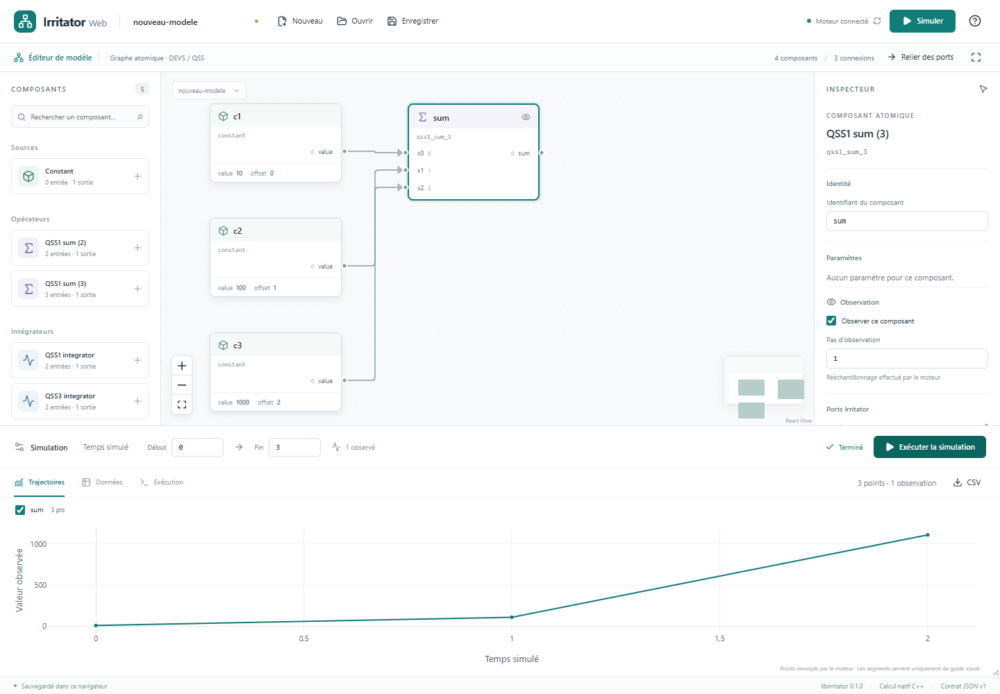
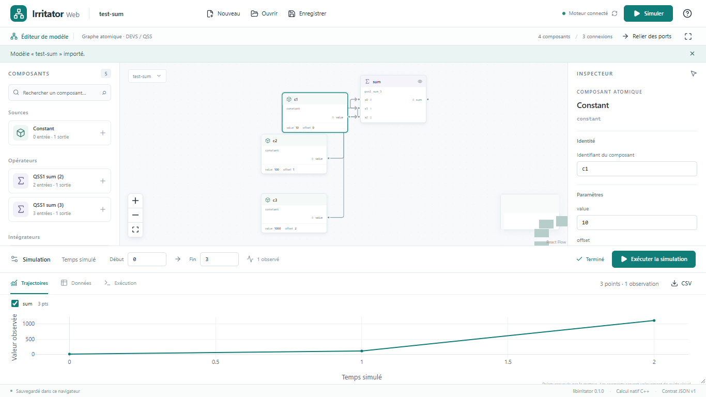

# Test 5 — Modélisation et simulation graphiques dans le navigateur

Campagne du **21 octobre 2026**, Windows, dépôt `D:\these\irritator`.

**Le parcours principal fonctionne : on construit un graphe dans React Flow,
on règle ses paramètres et observations, puis Fastify exécute ce graphe dans
le véritable moteur C++ Irritator. Aucun code C++ ni JSON manuel n’est nécessaire
pour les expériences construites graphiquement ci-dessous.**

## 1. Objectif et périmètre

Première interface web générique : bibliothèque, nœuds et ports, connexions,
inspecteur, observations, bornes, exécution HTTP, courbes, tableau, import/export.
Le backend et le runner validés au Test 4 sont réutilisés intégralement.
Le moteur, les algorithmes QSS et `simulation_wrapper` ne sont pas modifiés.

## 2. État Git initial et préservation

Branche initiale et finale : `for-web-ui`. HEAD :
`58cf7fd419a289bb5d1f1c3bcef6b043d35082af` (`Update .gitignore`).
`origin=https://github.com/Edouard1er/irritator.git` ;
`upstream=https://github.com/vle-forge/irritator.git`.

État initial : `.gitignore`, `lib/include/irritator/core.hpp` et
`lib/src/simulation.cpp` déjà modifiés ; `reports/` et `web/` non suivis.
Ces changements sont conservés. Les quatre sous-modules sont aux mêmes commits
avant/après (fmt `1be298e1`, imgui `b48d1afb`, rapidjson `24b5e7a8`, ut `f923e6fe`).
Aucun changement de branche, de sous-module, de noyau, d’index, commit ou push.

Un inventaire SHA-256 pris avant implémentation et vérifié après les essais
confirme **99 fichiers inchangés**, incluant sources du moteur, tests,
démonstrations, rapports précédents, contrats, API, runner, exemples et les deux
fichiers npm du backend. Preuves : `build-web-test5/logs/preservation-before.json`
et `preservation-result.json`. Les avertissements d’accès au fichier Git ignore
global n’ont conduit à aucun changement de configuration globale.

## 3. Environnement réellement utilisé

Windows x64, PowerShell, Node.js **24.11.1**, npm **11.6.2**. Runner Release du
Test 4, lié à l’archive stabilisée du Test 3, moteur/adaptateur **0.1.0**.
SHA-256 du binaire `build-web-test4/runner/irritator-runner.exe` :
`631160674DAA9949D7698F1DE711D861FD63ED5154925B4CCF12536667FEB129`.
Aucune recompilation C++ pour les modifications de paramètres ou de topologie.

Google Chrome installé a été utilisé par Playwright, en mode headless, dans
des contextes de navigateur vierges ; il ne s’agit pas de jsdom pour les essais
de bout en bout. Le navigateur intégré a rencontré une erreur de connexion lors
du premier essai de compilation ; les captures livrées proviennent des essais
Chrome réussis sur l’application exécutée.

## 4. Dépendances résolues

| Dépendance | Version |
|---|---|
| Next.js / React / React DOM | 16.4.2 / 19.3.1 / 19.3.1 |
| React Flow `@xyflow/react` | 12.12.0 |
| Plotly `plotly.js-basic-dist-min` | 4.1.2 |
| Lucide React | 0.577.0 |
| TypeScript | 5.9.3, strict et noUncheckedIndexedAccess |
| Ajv | 8.17.1, même génération de contrat que le Test 4 |
| Vitest / jsdom | 5.0.5 / 27.4.0 |
| React Testing Library / user-event | 16.3.3 / 14.6.8 |
| Playwright Test | 1.64.1 |

Versions verrouillées dans `web/apps/frontend/package-lock.json`. Le package
du Test 4 et son verrou ne changent pas. Pas de workspaces : un package frontend
autonome suffit, tout en important les sources partagées par un alias explicite.

L’audit npm initial signale l’avis Ajv `GHSA-2g4f-4pwh-qvx6` concernant l’option
`$data`, qui n’est pas activée ici. Aucun schéma utilisateur n’est compilé.
Le Test 5 ne modifie pas les dépendances validées du backend ; leur mise à jour
mérite une campagne séparée. Résultat conservé dans `logs/npm-audit.json`.

## 5. Structure ajoutée

```text
web/apps/frontend/
  app/                         App Router, page, layout et style global
  components/editor/           orchestration de l’atelier
  components/nodes/            nœud Irritator générique et handles
  components/panels/           bibliothèque, inspecteur, champs et résultats
  components/charts/           adaptateur Plotly côté client
  lib/modeling/                état, identifiants, ports et validations
  lib/api/                     client HTTP et erreurs structurées
  lib/serialization/           workspace navigateur, téléchargement et CSV
  scripts/prepare-assets.mjs   copie locale de Plotly et de sa licence
  tests/                       Vitest / React Testing Library
  tests/e2e/                   scénarios Playwright
```

Next.js a généré `AGENTS.md` dans ce seul package ; les guides livrés avec cette
version de Next.js ont été consultés. Les dépendances, `.next`, caches et sorties
de tests sont ignorés. Plotly et sa licence sous `public/vendor` sont générés
par `predev` / `prebuild` depuis le paquet installé.

## 6. Architecture React

`ModelEditor` contient un `ReactFlowProvider`. Son état distingue `request`
(contrat scientifique `RunRequest`) de `positions` et `viewport`.
Sélections et mesures des nœuds sont des états de présentation séparés.
Bibliothèque, inspecteur et résultats sont des composants distincts.
Les limites sont celles du contrat partagé ; le serveur conserve l’autorité finale.
Aucun ordonnanceur, intégrateur ni algorithme DEVS n’est implémenté en React.

## 7. Intégration React Flow

Un seul type de nœud graphique affiche tout le catalogue reçu. Il comporte
identifiant, type, paramètres résumés, état sélectionné, observation et erreur.
Ajout par clic ou glisser-déposer, déplacement, zoom, ajustement de vue,
mini-carte et suppression sont implémentés. Les mesures visuelles restent hors
de la requête scientifique. Les couplages multiples vers un port sont permis.
Les cycles entre composants sont autorisés, sans validation de DAG.

## 8. Correspondance exacte des ports

Les handles sont `out:0`, `in:0`, `in:1`, etc., construits à partir des indices
du catalogue. Le parseur rejette les mauvais sens, formats et indices.
`c1/out:0 → sum/in:2` devient exactement :

```json
{"from":{"component":"c1","port":0},"to":{"component":"sum","port":2}}
```

Les positions ne participent jamais à cette conversion. Les références manquantes,
doublons stricts et auto-connexions refusées par le moteur sont rejetés.
Le formulaire **Relier des ports** offre un second parcours accessible au clavier.
Une arête peut être sélectionnée au clavier avec Entrée puis supprimée dans
l’inspecteur, y compris lorsque des zones de clic d’arêtes se superposent.

## 9. Contrat de sérialisation

`serializeModel` projette explicitement composants, paramètres, connexions,
observations, temps et limites facultatives dans `RunRequest`, puis appelle
`validateRequest` partagé. Aucun champ React Flow, position ou caméra n’en sort.
`deserializeModel` valide le document avant de l’installer et propose un placement
déterministe, borné même en présence de cycles.

Seule adaptation : le validateur **d’édition** dérive du même schéma avec
`minItems=0` pour les composants, afin d’ouvrir un document vide. L’exécution
et l’export scientifique gardent le schéma v1 inchangé (`minItems=1`).
Les limites facultatives importées sont conservées. L’aller-retour
export/import/export est testé pour sum3 et QSS3.

## 10. Communication avec Fastify

Les rewrites Next.js transmettent `/api/v1/*` au serveur existant sur 3001.
Les trois routes réelles ont été vérifiées : health, components, simulations/run.
Le frontend interprète `status=ok`, `runner.available=true`, les versions et
le schéma du handshake ; une réponse HTTP 200 quelconque ne suffit pas.
Le catalogue reçu est comparé structurellement au contrat partagé, sans dépendre
de l’ordre des clés JSON et sans bibliothèque de secours inventée.

Les réponses de simulation passent par le parseur partagé `parseResult` et
doivent porter un runId. Les codes/message/catégorie/code natif des erreurs sont
conservés. Un verrou empêche les doubles lancements. Aucun flux de progression
scientifique n’existe ; aucun pourcentage n’est affiché.

## 11. Fonctionnement et ergonomie

Thème clair, ressources locales, panneaux bibliothèque/canevas/inspecteur,
barre temporelle et panneau de résultats redimensionnable verticalement.
Le graphe occupe l’espace principal. Recherche et catégories sont dérivées
des cinq métadonnées reçues. Identifiants uniques ; un renommage valide remappe
connexions, observations et positions. Supprimer un composant retire ses références.
Les champs sont libellés et les focus visibles. La sélection combine couleur
et contour ; les erreurs ont un texte explicite.

Le parcours à 1366 × 768 est vérifié. Les panneaux latéraux défilent lorsque
nécessaire. Le zoom permet d’agrandir le graphe après un ajustement automatique.
Priorité desktop ; largeur minimale 1000 px.

## 12. Gestion des paramètres

Les champs sont générés depuis `parameters` / `required` du catalogue.
`constant` expose value et offset ; les intégrateurs X et dQ ; les sommes
n’inventent aucun paramètre. Les valeurs par défaut sont proposées dans les
bornes reçues. Les brouillons vides ou non finis restent visibles et invalides ;
ils ne sont jamais silencieusement remplacés par zéro ou une ancienne valeur.
Le catalogue et le schéma contrôlent bornes, paramètres requis et inconnus.
Les déplacements préservent les valeurs.

## 13. Observations et temps

Case d’observation par composant et pas configurable ; sortie conservée sous
`{component,samplingInterval}`. Les contraintes de pas, de temps flottant et
de grille potentielle maxPoints sont celles du Test 4. Les bornes imposent
start < end, horizon <= 1e9 et valeurs finies bornées.
Les observations sont supprimées avec leur composant. Leur ordre est envoyé
tel quel et vérifié dans la réponse.

## 14. Fidélité des résultats

Plotly est chargé uniquement côté client, depuis `/vendor/plotly-basic.min.js`.
Une série par observation, cases d’affichage, légende, survol, zoom et navigation.
Le tableau pagine les points réels et le CSV exporte toutes les observations,
même si une série est masquée. Les nombres ne sont pas arrondis avant export.
Aucun timestamp, point intermédiaire ou terminal n’est créé par le frontend.
Les segments sont explicitement présentés comme des guides visuels.

Le panneau Exécution affiche modelId/runId/statut, start/end/finalTime,
runCalls, versions, observations, pas et nombres de points. Il distingue
appels à l’ordonnanceur et événements physiques.
Les résultats portent l’empreinte du document soumis : toute modification
scientifique affiche leur ancienneté. Déplacer les nœuds ne l’affiche pas.
Un échec conserve la dernière réponse réussie.

## 15. Sauvegarde et import

Nouveau, ouverture JSON, export JSON v1 et sauvegarde automatique dans
localStorage, sous `irritator.workspace.v1`. Cette dernière stocke séparément
document scientifique, positions et caméra. Elle est restaurée au rechargement.
Les saisies invalides conservent la dernière sauvegarde valide et affichent un
statut explicite. Les erreurs de stockage sont interceptées.
Nouveau/Ouvrir et la fermeture de page avertissent des modifications non exportées.
Un import invalide ne remplace pas le travail. Les fichiers sont limités à 1 Mio.

## 16. Tests réellement exécutés

| Campagne | Résultat et nature |
|---|---|
| TypeScript strict / build Next.js de production | Succès, page prérendue puis application client |
| Vitest | **60/60** : 33 modèle/ports/CSV, 11 React, 16 client API ; mocks HTTP explicites |
| Playwright Chrome, version de production | **12/12**, vrais serveurs pour les expériences scientifiques ; pannes HTTP mockées explicitement |
| Test 4 `npm run test:all` | **73/73**, runner natif, API et processus, intégration HTTP réelle |
| Stabilisation Test 3 Release / Debug | **40/40** et **40/40** |
| Tests officiels utilisés au Test 4, Release / Debug | **4/4** et **4/4**, sources inchangées |
| Préservation SHA-256 | **99/99** fichiers identiques |

Les douze parcours navigateur couvrent : sum3 construit avec clics sur handles ;
paramètres modifiés ; CSV ; export/import/rechargement ; import de l’exemple ;
sum2 construit et suppression ; QSS1 ; QSS3 ; doublon et saisie invalide avec
récupération ; moteur indisponible ; catalogue indisponible ; fenêtre portable,
déplacement et suppression d’arête ; observations multiples et masquage ; import
invalide, timeout HTTP et récupération ; refus d’abandonner un modèle modifié.
Ils vérifient aussi l’absence d’exception JavaScript non interceptée et de
requête HTTP vers une origine extérieure à la boucle locale.

Une première invocation de CTest sur toutes les dix entrées du sous-dossier test
a trouvé six exécutables non construits et un échec natif `0xc0000409` de
test-mod-to-sim. La sélection exacte des quatre exécutables validés au Test 4,
relancée depuis la racine de construction, réussit ensuite dans les deux
configurations, sans modification des sources. La cause de cet échec initial
n’est pas attribuée avec certitude. Les six autres exécutables ne sont pas
annoncés comme validés. Aucun test officiel n’a été désactivé ou réécrit.

Journaux : `build-web-test5/logs/frontend-tests.log`, `frontend-build.log`,
`browser-production.log`, `playwright.json`, `web-test4.log`,
`stabilization-release/debug.log` et XML, `official-release-selected.log`,
`official-debug.log` et XML ; le journal du premier CTest est également conservé.

## 17. Oracles numériques vérifiés dans le navigateur

| Graphe construit ou importé | Points / oracle obtenus | Appels run() |
|---|---|---:|
| Trois constantes 10/100/1000 → sum3 | (0,10), (1,110), (2,1110) | 10 |
| Même graphe, valeurs -2/7/40 | (0,-2), (1,5), (2,45) | 10 |
| Export et réimport du modèle modifié | mêmes trois points | 10 |
| Import `web/examples/sum3.json` | mêmes points 10/110/1110 | 10 |
| Deux constantes -2/7 → sum2 | (0,-2), (1,5) | 7 |
| Constant 2 → QSS1, X=5, dQ=.25, [0,3[ | 31 points ; X=5+2t ; dernier (3,11) | 26 |
| Constant 2 → QSS3, mêmes conditions | 30 points ; X=5+2t ; dernier (3,11) | 4 |

Tolérance absolue **1e-9** pour ces graphes affines ; écart maximal constaté :
**0** dans les deux expériences. Les nombres différents de points sont conservés.
Le point terminal est fourni par le rééchantillonneur natif à sa fermeture ;
il ne représente pas l’exécution d’un événement à end.
Ces essais ne valident pas les problèmes QSS3 non linéaires.

Requêtes et réponses intégrales : `build-web-test5/logs/browser/*.json`.
Fichiers CSV exportés conservés dans ce même répertoire. Aucune réponse mockée
n’est utilisée pour établir ces oracles.

### État des critères demandés

| Fonctionnalité | Classement | Preuve |
|---|---|---|
| Next.js local et production | VALIDÉ | HTTP 200, build et Chrome |
| Communication avec Fastify | VALIDÉ | requêtes POST et réponses natives enregistrées |
| Catalogue API, cinq types | VALIDÉ | API réelle, bibliothèque et recherche testées |
| Ajout de nœuds par clic | VALIDÉ | graphes construits dans Chrome |
| Paramètres et observations | VALIDÉ | éditions et expériences exécutées |
| Handles et indices natifs | VALIDÉ | sum3 branché via les handles 0/1/2 |
| Export/import JSON v1 | VALIDÉ | aller-retour, exécution réimportée et tests de contrat |
| Résultats Plotly/tableau/CSV | VALIDÉ | séries tracées, valeurs visibles et CSV exact |
| Sum3 de référence / modifié | VALIDÉ | 10/110/1110 et -2/5/45 |
| Autre topologie | VALIDÉ | sum2 construit et exécuté |
| QSS1 / QSS3 affines | VALIDÉ | tous les points comparés à 5+2t |
| Erreurs sans plantage | VALIDÉ | cas HTTP, import, paramètres, reprise ; aucune exception page |
| Non-régression Test 4 et stabilisation | VALIDÉ | 73 + 40 Release + 40 Debug |
| Tous les dix tests officiels enregistrés | PARTIELLEMENT VALIDÉ | quatre binaires du périmètre Test 4 réussissent ; six non construits |
| Persistance et avertissement de perte | VALIDÉ | rechargement et confirmation refusée dans Chrome |
| Glisser-déposer depuis le catalogue | NON TESTÉ | implémenté, parcours de validation effectué par clic |
| Redimensionnement manuel des résultats | NON TESTÉ | CSS présent, pas de geste automatisé |
| Annulation confirmée à travers Next.js | NON VALIDÉ | aucune fonction/bouton d’annulation annoncé |

## 18. Limites connues

Catalogue limité aux cinq composants atomiques du Test 4. Pas de hiérarchie,
modèle halieutique, triade T*, simulation_wrapper graphique, plans d’expérience,
import natif, base de données, authentification, streaming ou calcul distribué.
Pas encore d’annuler/rétablir ni de fichier de workspace portable avec positions.
La sauvegarde locale est propre à l’origine et au navigateur ; exporter le JSON
pour conserver durablement le modèle scientifique.

Le backend sait arrêter un processus après déconnexion HTTP, mais aucun accusé
d’annulation n’est fourni à travers les rewrites. L’interface ne prétend donc pas
offrir une annulation confirmée. Les limites et timeouts du Test 4 restent actifs.
Les tests de quota localStorage et de toutes les tailles de graphe ne sont pas
annoncés comme essais de bout en bout. Le runtime testé utilise le runner Release ;
la stabilisation et les quatre tests officiels ont aussi été exécutés en Debug.

## 19. Erreurs rencontrées et corrigées

- Webpack a épuisé la mémoire sur ce poste. Le démarrage et le build ont été
  basculés sur Turbopack, le chemin standard de cette version de Next.js.
  Le bundle Plotly est servi comme ressource locale plutôt que reparsé dans
  le bundle applicatif ; build et navigateur fonctionnent sans CDN.
- Le port 3000 était initialement occupé par une autre application : premiers
  essais sur 3002 sans l’interrompre. Après libération, développement sur 3000
  et vérification de production séparée sur 3002.
- Le rejeu des effets React StrictMode doublait le handshake et dépassait les
  deux processus du backend. Un verrou local déduplique la vérification.
- Les libellés numériques incluaient les textes d’aide : un nom accessible
  explicite les rend stables et précis.
- La détection de TimeoutError reposait sur instanceof Error, insuffisant entre
  certains contextes DOM : le nom de l’erreur est maintenant contrôlé.
- Les mesures graphiques et les sélections d’arêtes au clavier sont conservées
  dans l’état de présentation contrôlé de React Flow.
- Après restauration locale, l’arrivée asynchrone du catalogue déclenche
  explicitement la nouvelle mesure des handles, même si la taille du nœud
  reste identique ; le test de rechargement vérifie les trois arêtes redessinées.
- Le premier test de clic sur une arête a rencontré une autre zone de sélection
  superposée. La sélection clavier, ajoutée à l’état contrôlé, est testée et
  permet de choisir cette arête précisément.
- Les assertions de tests sur role=alert incluaient l’annonceur Next.js ; elles
  ciblent maintenant le message utilisateur pertinent.

## 20. Modifications du dépôt et captures réelles

Ajout de `web/apps/frontend/`, de ce rapport et des captures.
`web/README.md` pointe maintenant vers l’éditeur. `.gitignore` autorise le suivi
du rapport et de son répertoire de captures. Aucune modification de l’API,
des contrats, du runner ou des deux fichiers npm du Test 4.





Ces captures sont produites par Playwright depuis l’application réelle ;
aucune maquette ou image générée ne sert de preuve.

## 21. Reproduction et suites proposées

Les commandes complètes et le parcours manuel se trouvent dans
[`web/apps/frontend/README.md`](../web/apps/frontend/README.md).
Démarrer Fastify depuis web (`npm ci`, `npm run build`, `npm start`), puis
Next.js depuis web/apps/frontend (`npm ci`, `npm run dev`). Ouvrir
`http://127.0.0.1:3000`. Pour la production : `npm run build`, `npm start`.
Pour les essais : `npm test`, puis `npm run test:e2e` avec les deux serveurs actifs.

Développements suivants recommandés : annuler/rétablir, fichiers de workspace
versionnés, gestion explicite des jobs et de leur annulation, puis modèles
couplés avec extension contractuelle contrôlée. Étudier séparément la configuration
graphique des expériences imbriquées, en conservant les mécanismes du wrapper
stabilisé. Étendre progressivement les oracles scientifiques avant d’élargir
les affirmations de validité QSS.

Références de mise en œuvre consultées :
[Next.js, installation](https://nextjs.org/docs/app/getting-started/installation),
[rewrites](https://nextjs.org/docs/app/api-reference/config/next-config-js/rewrites),
[React Flow, validation](https://reactflow.dev/examples/interaction/validation),
[handles](https://reactflow.dev/api-reference/components/handle),
[Plotly, configuration](https://plotly.com/javascript/configuration-options/),
ainsi que les guides Next.js livrés localement avec la version installée.
