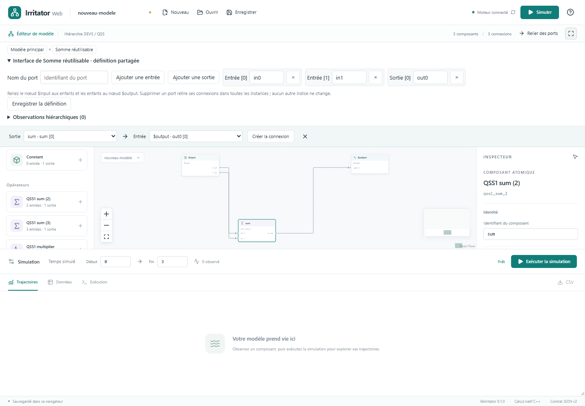
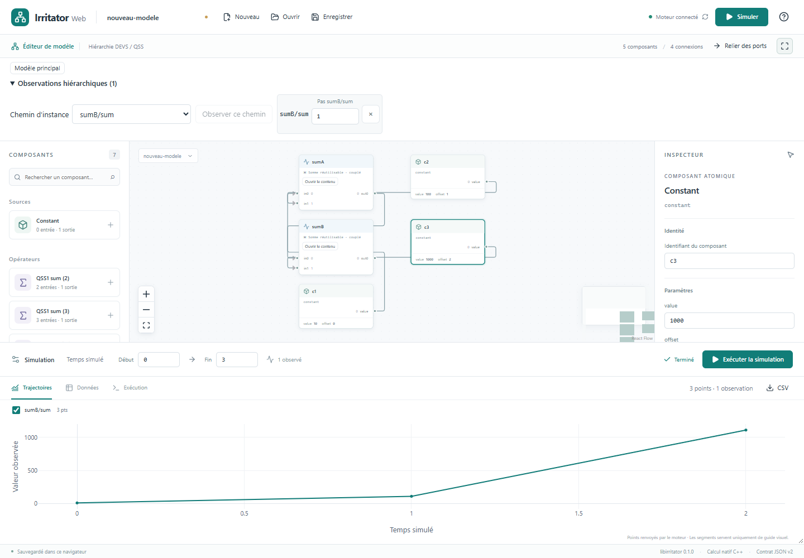
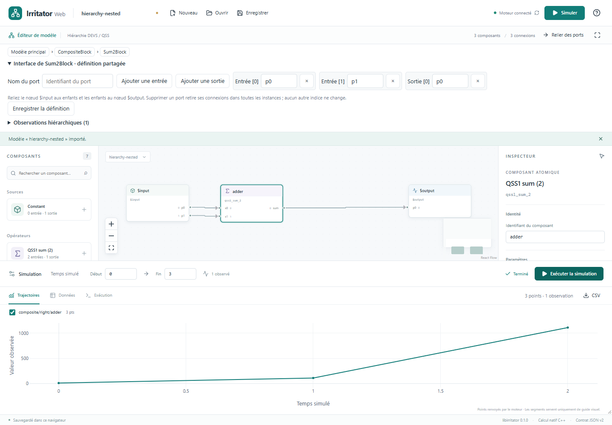

# Test 6 — Composition DEVS hiérarchique

## Décision préalable à l’implémentation (21 octobre 2026)

Git initial : arbre propre, branche `for-web-ui`, HEAD `fc76ddb2` (Test 5).
Les cinq commandes Git prescrites ont été exécutées ; sous-modules inchangés.
Les rapports 3, 4 et 5 et les contrats v1 ont été lus. Les corrections du Test 3
sont présentes dans les sources et seront contrôlées par leurs tests existants.

### Analyse native et stratégie

`lib/include/irritator/modeling.hpp` déclare `generic_component::child` :
un enfant contient soit `dynamics_type`, soit une référence `component_id`.
Les paramètres sont dans `children_parameters`, les identifiants locaux dans
`children_names`. `component::x/y` déclarent les interfaces par `port_id`.
`generic_component::connect`, `connect_input` et `connect_output`
(`lib/src/modeling-generic.cpp`) représentent respectivement IC, EIC et EOC.
La distinction `connection::port.model` / `.compo` doit être respectée.

`modeling` fournit les accès synchronisés `ids` (`component_access`) et `files`
(`file_access`). Le runner peut utiliser ces conteneurs directement, en mémoire,
sans charger de fichier ni exposer les références de ressources natives.
Les exemples officiels de `test/mod-to-sim.cpp` emploient
`alloc_generic_component`, `gen.alloc`, les paramètres, puis `project::set`.
`project::rebuild` rappelle `set` avec la racine courante : ce n’est pas une
autre sémantique. Dans `lib/src/project.cpp`, `make_tree_recursive` et
`make_tree_leaf` allouent des modèles et états distincts pour chaque occurrence,
puis `simulation_copy_connections` résout les interfaces récursivement.
Les `tree_node::children` remappent les `child_id` vers les vrais `model_id`.
Les noms JSON ne doivent jamais être convertis en identifiants numériques.

La sérialisation native (`lib/src/json.cpp`, `read_input_connection`,
`read_output_connection`, `write_input_connection`, `write_output_connection`)
porte aussi chemins, catalogue, positions et sources. Elle n’est pas exposée
au web. La réutilisation repose sur les références aux composants ; `copy_to`
et `component_access::copy` servent à dupliquer des définitions natives mais ne
sont pas nécessaires pour instancier plusieurs fois une définition partagée.

**Décision :** garder le chemin plat v1 et ajouter un contrat autonome v2,
avec définitions couplées, enfants référencés, interfaces et chemins d’observation.
Construire un `component_access` natif puis appeler `project::set` une seule fois.
Le C++ seul produit la simulation exécutable ; TypeScript valide des structures
et budgets, React édite des portées. Aucun ordonnanceur web.
Les indices externes restent stables après suppression de ports.
Profondeur et nombre d’occurrences sont bornés avant conversion native.

### Catalogue retenu

Deux ajouts réels de `core.hpp` : `qss2_integrator = abstract_integrator<2>`
(X, dQ, dérivée/reset, état observé X) et
`qss1_multiplier = abstract_multiplier<1>` (deux entrées, une sortie produit,
états d’entrée initialisés à zéro, aucun paramètre). Les autres familles QSS,
sommes, puissances, fonctions, compteurs, files, logique, générateurs, HSM et
wrapper existent dans `dynamics_type` ; leurs ressources ou conventions ne sont
pas exposées sans campagne propre. Priorité à la hiérarchie.

## 1. Résultat et périmètre effectivement livré

**Oui : l’éditeur construit, réutilise et exécute des modèles DEVS couplés à
plusieurs niveaux avec la composition native d’Irritator.** La somme graphique
à deux instances donne exactement les trois points attendus, y compris après
export/import et modification des seules positions. Deux occurrences d’une
même définition à état restent indépendantes. La précision analytique de
l’observation QSS2 a une limite initiale explicitée ci-dessous.

Aucun changement de libirritator, des sous-modules ou de `simulation_wrapper`.
Aucun modèle T*, code utilisateur, ordonnanceur JS, import natif complet,
streaming, base de données ou authentification.

## 2. Git et préservation

État initial propre ; branche initiale/finale `for-web-ui`, HEAD `fc76ddb2`
(`Test 5`). Remotes : `origin=https://github.com/Edouard1er/irritator.git`,
`upstream=https://github.com/vle-forge/irritator.git`. Aucun changement d’index,
commit, push, reset ou changement de branche. Les cinq sous-modules récursifs
restent aux commits fmt `1be298e1`, imgui `b48d1afb`, rapidjson `24b5e7a8`,
gtest `ba96d0b1`, ut `f923e6fe`.

Les corrections Test 3 sont bien intégrées : file `pending_responses`, état
initialisé après initialisation des simulations imbriquées, recalcul du sigma
et fermeture terminale des observations. `core.hpp` et `simulation.cpp` sont
identiques avant/après cette campagne, ainsi que les autres sources natives et
tests inclus dans l’inventaire. **77/77 fichiers protégés inchangés**, SHA-256
dans `build-web-test6/logs/preservation-before.json` et `preservation-result.json`.
Cet inventaire suit les fichiers visibles par `rg` (les demos et anciens rapports
ignorés ne sont pas tous inclus) ; aucun fichier de démonstration n’a été édité.
Les rapports et captures du Test 5 sont conservés. Les sorties de sa nouvelle
exécution sont dirigées vers les preuves du Test 6.

Les changements sont sous `web/` et dans ce rapport et ses captures. Deux
exceptions précises ont été ajoutées à `.gitignore` pour rendre le nouveau
rapport et ses captures visibles dans Git, sans ajout automatique à l’index.
Les avertissements d’accès au fichier global Git ignore n’ont entraîné aucun
changement de configuration globale.

## 3. Environnement et constructions

Windows x64, PowerShell, Node **24.11.1**, npm **11.6.2**, MSVC
**19.51.36260.0**, Visual Studio 2026, C++20, CMake/Ninja.
Archives stabilisées du Test 3 : `build-wrapper-test3/lib/irritators-0.1.lib`
et `build-wrapper-test3-debug/lib/irritators-0.1.lib`.
Runners reconstruits séparément dans `build-web-test6/runner` et `runner-debug`.
Empreintes dans `logs/binaries.json`, journaux de construction Release/Debug
dans `build-web-test6/logs/runner*-build.log`.

Les versions npm/verrous restent inchangés : Next.js 16.4.2, React 19.3.1,
React Flow 12.12.0, Plotly 4.1.2, TypeScript 5.9.3, Ajv 8.17.1,
Vitest 5.0.5, Playwright 1.64.1, Fastify 5.12.7.
Les guides de la version locale de Next ont été lus conformément à son AGENTS.md.
Chrome installé, headless, vrais contextes navigateur et version de production.
Le serveur essayé écoute sur 3003, Fastify sur 3001 ; les commandes habituelles
gardent le port frontend 3000. Les requêtes scientifiques ne sont pas mockées.

## 4. Contrat scientifique v2 et compatibilité

Schéma : `web/packages/contracts/request-v2.schema.json` ; spécification et
extrait complet : `web/packages/contracts/README.md`. Le fichier de schéma v1
est inchangé. La version du **document scientifique** est 1 ou 2 ; les enveloppes
HTTP, catalogue et résultat conservent leur structure de version 1.

La racine garde `components`, `connections`, `observations`, `simulation`.
Le v2 exige `model.definitions`. Une définition comprend `id`, `name`,
`inputs`, `outputs`, `components`, `connections`. Une instance est un enfant
`{id,type:"coupled",definition,parameters:{}}`. Une définition est partagée,
sans override de paramètres par occurrence. Les entrées différentes permettent
des comportements différents sans partager les états.

EIC : `$input` → enfant ; IC : enfant → enfant ; EOC : enfant → `$output`.
Les noms d’extrémités restent locaux ; aucun chemin traversant directement une
portée n’est accepté dans une connexion. Les indices externes sont explicites,
distincts et stables, même s’ils sont creux après suppression. Un port déclaré
doit aboutir à un port atomique avant exécution. Les brouillons incomplets
restent éditables et sauvegardables localement.

Les observations désignent un **chemin d’instances vers un atome**, par exemple
`sumB/sum` et `composite/right/sum`. Le nom d’une définition n’est pas une portée
d’exécution ; c’est chaque occurrence qui en crée une. Les ports couplés ne
sont pas des états observables ; observer leur producteur atomique est supporté.

Lecture/exécution/import/export v1 conservés. Un nouveau modèle reste v1 jusqu’à
la création d’une définition ; les fichiers v2 importés gardent leur version.
Tous les exemples précédents sont inchangés. Le contrat interdit tout champ de
code, ressource distante, chemin utilisateur ou bibliothèque dynamique.

## 5. Catalogue atomique et mécanismes d’allocation

L’énumération complète `dynamics_type` de `core.hpp` a été examinée : familles
QSS1/2/3 (intégrateurs, produits, cross, hold, flipflop, filtres, puissances,
sommes 2/3/4, sommes pondérées, gain, fonctions, quantification, hystérésis,
etc.), compteur, files, générateur, constante, fonction temporelle,
accumulateur, logique, HSM et simulation_wrapper. Les paramètres natifs sont
initialisés/appliqués par `lib/src/parameter.cpp`. Le catalogue complet n’a pas
été exposé ni déclaré validé ; chaque autre famille demanderait ses contraintes,
ressources et oracles propres. Les deux ajouts demandés sont pleinement reliés
au runner, au contrat, à HTTP et à l’inspecteur générique.

| Type ajouté | Fonction / état initial | Paramètres et contraintes web | Ports | Création / observation |
|---|---|---|---|---|
| `qss2_integrator` | Intègre dX/dt ; X imposé, dérivée initialement nulle | X fini ±1e12 ; dQ entre 1e-9 et 1e12 ; défaut éditeur X=0, dQ=.1 | x0 dérivée, x1 reset, y0 X | `simulation.alloc<qss2_integrator>` en v1 ; `gen.alloc(dynamics_type::qss2_integrator)` et `set_integrator` en v2 ; observation native X |
| `qss1_multiplier` | Produit des deux dernières valeurs reçues ; facteurs initialisés à zéro | Aucun paramètre | x0, x1 facteurs ; y0 produit | `simulation.alloc<qss1_multiplier>` ou `gen.alloc(dynamics_type::qss1_multiplier)` ; observation native du produit |

`registry` et `native_hierarchy::dynamics` utilisent uniquement les sept types
autorisés. `catalog.json` décrit les mêmes types ; le handshake compare le
catalogue embarqué par CMake au catalogue partagé. Aucun formulaire spécialisé
React n’a été introduit pour ces deux types. Fichiers exécutables directement :
`web/examples/qss2_integrator.json`, `multiplier.json`.

## 6. Traduction native et remappage

`web/engine/runner/hierarchy.hpp::native_hierarchy` valide d’abord le document
et ses budgets, sans allouer d’objet moteur. `declare` crée une seule définition
native par définition JSON et une racine synthétique. `fill` alloue les enfants,
associe les paramètres et crée les trois catégories de connexions.

API natives réellement utilisées :

- `component_access::can_alloc_generic_component` / `alloc_generic_component` ;
- `component::get_or_add_x`, `get_or_add_y` ;
- `generic_component::grow_children`, `alloc(dynamics_type)`, `alloc(component_id)` ;
- `children_parameters[child_id].set_constant` / `.set_integrator` ;
- `generic_component::connect`, `.connect_input`, `.connect_output` ;
- `project::set(const component_access&,const file_access&,component_id)` ;
- `project::tn_head`, `tree_node::children` pour retrouver les modèles alloués ;
- `simulation::observe`, `initialize`, `run`, `tick_resamplers`, `finalize` et
  les historiques/fermetures de rééchantillonneurs déjà utilisés par v1.

Pour un enfant atomique, `connection::port.model` reçoit l’indice numérique ;
pour un enfant couplé, `.compo` reçoit le vrai `port_id` déclaré dans sa
définition native. Mélanger ces deux représentations serait incorrect.
`project.cpp::simulation_copy_connections` résout les interfaces jusqu’aux
atomes ; l’adaptateur ne remplace pas ce mécanisme.

Les tables JSON→`child_id` sont par définition ; après `project::set`, `collect`
parcourt **chaque occurrence** dans l’arbre natif et constitue la table
chemin→`model_id`. Les noms natifs sont générés courts (`n0`, `p0`…) pour éviter
la troncature de noms JSON dans `name_str`. Le texte JSON est conservé dans la
table de traduction, sans supposer de correspondance numérique.

Le runner vérifie que le nombre de chemins remappés égale celui des modèles
natifs et que tous les `model_id` sont distincts. Les résultats v2 portent les
diagnostics `nativeModelCount` et `distinctNativeModelIds`. Les deux sommes
ont cinq atomes natifs distincts ; l’expérience indépendante en a quatre.

La hiérarchie couplée possède une horloge de simulation commune. Elle n’est
pas un mécanisme de simulations imbriquées avec horloges autonomes : ce dernier
reste la responsabilité du wrapper existant et n’a pas été modifié.

## 7. Backend, ressources et erreurs

Les trois routes HTTP restent identiques. `validateRequest` choisit le schéma
v1/v2, puis valide références locales, paramètres, interfaces, observations et
graphe de dépendances. La route l’appelle avant `engine.run` ; `ProcessEngine`
applique les limites serveur et revalide avant `spawn`. Le runner répète ces
contrôles indépendamment, pour les appels sans HTTP.

Plafonds : 64 définitions, 128 atomes après expansion, 512 connexions exécutables,
512 occurrences (atomiques et couplées), huit niveaux couplés hors racine,
16 ports par direction, 32 observations, 100 000 appels run, 20 000 points,
1 Mio JSON. Les limites v2 `maxDepth`/`maxInstances` et les variables serveur
`ENGINE_MAX_DEPTH`/`ENGINE_MAX_INSTANCES` peuvent seulement les abaisser.
Les définitions inutilisées doivent aussi être valides et tenir dans le budget.

Le précontrôle compte les sources/destinations atomiques par interface : une
connexion de deux sources vers deux destinations coûte quatre connexions.
Un test ne contenant que deux arêtes racines produit un coût de six connexions
et est rejeté sous un budget de cinq, dans les deux validateurs. Les occurrences
d’une définition commune sont chacune comptées. Les parcours sont bornés avant
conversion. Les cycles de connexions restent autorisés ; un feedback qui ne
progresse pas temporellement est arrêté par le budget run ou le timeout.

Codes explicites : `DEFINITION_NOT_FOUND`, `INVALID_EXTERNAL_PORT`,
`INVALID_SCOPE`, `RECURSIVE_DEFINITION`, `HIERARCHY_DEPTH`, `EXPANSION_LIMIT`,
`NATIVE_CONSTRUCTION_ERROR`, `OBSERVATION_ERROR`, plus les erreurs v1 conservées.
L’enveloppe existante et la catégorie/code moteur sont conservées. Des tests
prouvent le rejet applicatif avant lancement ; les erreurs purement natives
remontent en 422. Timeout, concurrence, bornes stdout/stderr et nettoyage des
processus gardent leurs mécanismes historiques.

## 8. Éditeur, interfaces, navigation et persistance

Le catalogue atomique reçu par HTTP reste distinct de **Mes composants**.
Créer une définition permet de choisir id/nom, ajouter et nommer ses ports,
ouvrir son contenu, ajouter enfants atomiques ou couplés, relier leurs ports
par handles ou formulaire accessible, puis enregistrer la définition et insérer
plusieurs instances. Chaque occurrence a son identifiant. La politique affichée
est une définition **commune partagée** : modifier son contenu affecte tous ses
usages, sans fusionner les états des simulations.

Le fil d’Ariane change uniquement la portée visible. Deux nœuds d’interface
représentent les entrées et sorties externes. Les nœuds couplés portent les vrais
ports déclarés et l’action **Ouvrir le contenu**. Les connexions ne peuvent
viser que les enfants de cette portée. La suppression d’un port retire les
couplages internes et ceux de toutes les occurrences utilisant cet indice,
affiche le nombre de connexions retirées et ne réindexe aucun autre port.
Les observations sont choisies par chemin d’instance ; les renommages de nœuds
ou d’enfants partagés remappent les chemins.

Le thème clair, bibliothèque, inspecteur, Nouveau/Ouvrir/Enregistrer,
React Flow, panneau de simulation, Plotly, tableaux et CSV sont préservés.
Les types ajoutés utilisent les champs génériques du catalogue.

Les fichiers scientifiques v2 contiennent seulement le modèle et ses limites.
Le workspace `irritator.workspace.v2` conserve positions/caméra racine,
positions/caméra par définition et navigation. `irritator.workspace.v1` est lu
et migré sans réécriture de sa clé. Une migration/restauration échouée laisse
les octets d’origine intacts et bloque l’autosauvegarde jusqu’à une action
explicite Nouveau ou import réussi. Ces deux comportements sont testés dans
Chrome. Les imports invalides conservent le travail courant.

## 9. Expériences et oracles

### H — Composition Sum2Block

`hierarchy-sum.json` : Sum2Block contient `qss1_sum_2`, deux EIC et un EOC.
La racine contient c1=10 à 0, c2=100 à 1, c3=1000 à 2, sumA et sumB.
c1/c2 alimentent sumA ; sumA et c3 alimentent sumB. Horizon `[0,3[`, pas 1,
observation `sumB/sum`.

| Temps | Hiérarchique | Plat `sum3.json` |
|---|---:|---:|
| 0 | 10 | 10 |
| 1 | 110 | 110 |
| 2 | 1110 | 1110 |

Égalité exacte de tous les échantillons publiés, en runner direct, HTTP réel et
Chrome. 14 appels run contre 10 pour le graphe plat (deux sommes plutôt qu’une).
Un appel run n’est pas un événement physique unique. Aucun epsilon ni échantillon
intermédiaire artificiel. Export/import et changement des positions donnent les
mêmes observations. Les événements à 3 restent exclus.

### I — Deux niveaux couplés

`hierarchy-nested.json` : CompositeBlock contient `left` et `right`, deux usages
de Sum2Block ; la racine utilise `composite`. Trois entrées externes traversent
les deux niveaux ; une sortie repart vers l’interface CompositeBlock.
Observation `composite/right/sum`, mêmes conditions et mêmes trois valeurs.
Les cinq modèles natifs sont distincts. Dans Chrome, le renommage de l’enfant
partagé `sum` en `adder` remappe l’observation vers `composite/right/adder`,
préserve les connexions et les résultats, puis résiste au rechargement et
à l’export/import. Les arêtes internes sont effectivement visibles après renommage.

### J — États indépendants

`hierarchy-independent.json` : deux occurrences `up` et `down` de la même
définition IntegratorBlock, contenant un QSS2 `state`, X(0)=5, dQ=.25.
Dérivées constantes respectives 2 et −3, horizon `[0,3[`, pas .1.
Oracles continus : Xup=5+2t ; Xdown=5−3t. Les deux trajectoires contiennent
31 échantillons, terminaux `(3,11)` et `(3,−4)`, cinq appels run au total.
Les quatre modèles natifs possèdent des identifiants distincts.

Les références plates avec un seul intégrateur par entrée donnent exactement
les mêmes échantillons. Relancer la même requête reproduit les trajectoires.
Modifier seulement la dérivée de up de 2 à 7 laisse la trajectoire down
strictement identique. Aucun état ne fuit d’une occurrence à l’autre.

### K — Catalogue et précision QSS2

QSS2 : X(0)=5, dQ=.25, dérivées −2,0,2 en runner direct, dérivée 2 également
HTTP/React. **L’oracle analytique à 1e-9 sur tous les points a initialement
échoué**, car la sortie native à t=.1 vaut 5.192 pour la dérivée 2, au lieu
de 5.2. Écart maximal 0.008000000000000007 ; pour down (−3), écart maximal
2.22e-15. Les plateaux et nombres de points natifs sont conservés.

Analyse : `qss_interpolator::evaluate` (`core.hpp`) sélectionne
`hermite_cubic` pour QSS2 ; `resampler::commit_pending` (`observer.cpp`)
interpole les échantillons bruts. L’initialisation porte une pente nulle,
puis l’entrée fixe la dérivée à 2 à t=0 ; le premier segment se termine à
dQ/2=.125. Pour les ancres (0,5,pente 0) et (.125,5.25,pente 2), à .1,
u=.8 et Hermite donne 5.192. Cette formule explique l’écart, déjà présent
dans la référence plate native. Les segments ultérieurs sont affines.

Les nouveaux tests annoncent donc une tolérance analytique absolue **.01 pour
cette expérience**, et **1e-9 aux instants de référence 1,2,3**. Ils exigent en
plus une égalité exacte avec la référence native plate. Ce n’est pas une garantie
générale de précision QSS2 sur tout système. Aucun code moteur ni résultat
attendu historique QSS1/QSS3 n’a été changé pour faire passer cet essai.

Multiplicateur : facteurs 2 et 3 à t=0 donnent exactement 6 ; une mise à jour
du second facteur vers 5 à t=1 donne exactement 10 dans le runner direct.
Le produit initial 6 est aussi construit/configuré et vérifié par HTTP et
dans React Flow. Aucun paramètre arbitraire n’est ajouté.

Preuves intégrales : `build-web-test6/logs/*-native.json`,
`scientific-summary.json`, `hierarchy-http.json`, `browser/*.json`,
`browser-regression/*.json`. Les données reçues sont enregistrées avant toute
visualisation ; Plotly ne sert pas d’oracle numérique.

## 10. Tests réellement exécutés

| Campagne finale | Résultat |
|---|---|
| Build C++20 runner Release / Debug | Succès / succès |
| Runner + backend Release | **111/111** (73 historiques + 38 nouveaux) |
| Runner + backend Debug | **111/111** après correction du synchronisme d’un ancien test |
| Dont runner direct (par configuration) | **55/55**, dont 22 nouveaux cas hiérarchiques/catalogue |
| Dont API/processus/HTTP (par configuration) | **56/56**, dont 16 nouveaux cas |
| TypeScript strict frontend / build Next production | Succès / succès |
| Vitest frontend | **70/70** (60 historiques + 10 hiérarchie/persistance) |
| Playwright Chrome, production | **16/16** (12 historiques + 4 nouveaux) |
| Stabilisation wrapper Release / Debug | **40/40** / **40/40** |
| Quatre exécutables officiels Release / Debug | **4/4** / **4/4** |
| Préservation SHA-256 | **77/77** |

Nouveaux tests : schémas, DAG/récursion, profondeur, occurrences, atomes,
fanout/fanin après expansion, port non déclaré ou non relié, mauvaise portée,
observations non résolues, feedback DEVS avec limite run, références plates,
états et identifiants distincts, répétition, import/export, définition partagée,
suppression de ports sans réindexation et migration.

Les tests scientifiques HTTP utilisent TCP réel ou injection Fastify avec un
vrai ProcessEngine ; les rejets avant lancement emploient explicitement un
moteur sentinelle pour prouver l’absence d’appel. Les fixtures et interceptions
HTTP historiques servent aux pannes et contrôles de processus, jamais aux
preuves scientifiques. Les parcours Chrome nouveaux construisent les modèles
ou importent les exemples, observent les vraies réponses natives et les exportent.

Journaux : `all-backend-native.log`, `all-backend-native-debug-retest.log`,
`frontend-test.log`, `frontend-build.log`, `playwright-production.log`,
`stabilization-release/debug.log` et XML, `official-release/debug.log` et XML,
tous sous `build-web-test6/logs/`. Les fichiers sources et commandes des tests
sont livrés sous `web/` ; les logs sont des produits de construction ignorés.

## 11. Anomalies, corrections et limites

- **QSS2 :** précision initiale du rééchantillonnage Hermite limitée, analysée
  ci-dessus ; comportement natif conservé, sans refonte du noyau.
- **Course dans l’ancien test HTTP de déconnexion :** un premier lancement
  Debug a donné 110 succès et un test annulé par timeout à 15 s ; le retest
  isolé reproduisait le timeout. Une sonde a montré un POST en 503 ENGINE_BUSY
  à ~102 ms, alors que les health concurrents réussissaient ensuite : le
  `--describe` de la vérification de santé avait pris le seul créneau avant
  l’arrivée du POST TCP. Ce test n’observait donc pas une simulation active.
  Il attend désormais le lancement réel via le hook de création de processus
  de ProcessEngine avant de contrôler la saturation et la déconnexion. Le vrai
  runner est toujours lancé ; aucune assertion, borne de 15 s ni oracle
  scientifique n’a changé. Les campagnes finales Release et Debug passent.
  Preuves : `debug-disconnect-race.json`, `debug-feedback-diagnostic.json`,
  les deux premiers journaux Debug et le journal final `*-debug-retest.log`.
- **Historique Test 5 :** l’échec initial `0xc0000409` de test-mod-to-sim après
  une invocation CTest trop large reste une anomalie historique sans cause
  établie. Il n’est pas attribué à la hiérarchie. La sélection exacte des quatre
  exécutables passe ici en Release et Debug ; les six autres entrées CTest
  hors périmètre ne sont pas annoncées validées.
- **Développement frontend :** un premier lancement navigateur rencontrait une
  résolution `.js` vers des sources TypeScript partagées incompatible avec
  Turbopack ; le validateur partagé a été regroupé dans son point d’entrée.
  Les retests complets passent. Le test de bibliothèque compte désormais les
  sept métadonnées reçues au lieu de figer la cardinalité historique à cinq.
- **Concurrence navigateur :** une ouverture supplémentaire du navigateur
  intégré pendant un retest de production a fait dépasser le plafond historique
  de deux processus lors des handshakes. Un parcours attendait le moteur alors
  que l’interface affichait explicitement `ENGINE_BUSY` ; les 15 autres passaient.
  Le journal `playwright-production-concurrent-browser.log` conserve cet essai.
  Le plafond et les assertions sont conservés ; la campagne est relancée sans
  ouverture simultanée d’un autre client. Le bouton de reconnexion permet aussi
  de reprendre une session refusée pour saturation.
- Observations d’atomes internes seulement ; pas d’observateur synthétique de
  sortie couplée. Pas d’override par occurrence, de versionnement de définition,
  d’annuler/rétablir ou d’export portable des seules données graphiques.
- Le budget de connexions est conservateur lorsque plusieurs chemins
  d’interface aboutissent aux mêmes extrémités. Une définition inutilisée
  invalide bloque le document ; cette politique est explicite dans le contrat.
- Les limites mémoire OS, le streaming et les garanties numériques sur des
  systèmes QSS non linéaires restent hors campagne. Seul Windows/MSVC/Chrome
  est testé ici. La limite configurée à huit niveaux est validée par contrôles
  de profondeur ; les expériences scientifiques portent sur un et deux niveaux.

## 12. Captures réelles







## 13. Reproduction PowerShell

Les README `web/README.md`, `web/apps/frontend/README.md`,
`web/packages/contracts/README.md` et `web/architecture.md` sont mis à jour.
Après chargement Developer PowerShell x64, depuis `D:\these\irritator` :

```powershell
cmake -S web/engine/runner -B build-web-test6/runner -G Ninja -DCMAKE_BUILD_TYPE=Release -DIRRITATOR_BUILD_DIR=D:/these/irritator/build-wrapper-test3
cmake --build build-web-test6/runner --parallel 2
cmake -S web/engine/runner -B build-web-test6/runner-debug -G Ninja -DCMAKE_BUILD_TYPE=Debug -DIRRITATOR_BUILD_DIR=D:/these/irritator/build-wrapper-test3-debug
cmake --build build-web-test6/runner-debug --parallel 2
$env:IRRITATOR_RUNNER=(Resolve-Path build-web-test6/runner/irritator-runner.exe).Path
Get-Content web/examples/hierarchy-sum.json -Raw | & $env:IRRITATOR_RUNNER
Get-Content web/examples/hierarchy-nested.json -Raw | & $env:IRRITATOR_RUNNER
Get-Content web/examples/hierarchy-independent.json -Raw | & $env:IRRITATOR_RUNNER

Set-Location web
npm.cmd ci
npm.cmd run test:all
# Répéter test:all avec IRRITATOR_RUNNER pointant vers runner-debug pour Debug.
npm.cmd start
```

Dans un autre terminal :

```powershell
Set-Location D:\these\irritator\web\apps\frontend
npm.cmd ci
npm.cmd run typecheck
npm.cmd test
npm.cmd run build
npm.cmd start -- --port 3003
```

Puis ouvrir `http://127.0.0.1:3003`. Construire Sum2Block en suivant le README
frontend ou importer les exemples. Les étapes graphiques et leurs contrôles
complets sont dans `tests/e2e/hierarchy.spec.ts`.

```powershell
# Troisième terminal, depuis web/apps/frontend :
$env:FRONTEND_URL='http://127.0.0.1:3003'
$env:IRRITATOR_BROWSER_EVIDENCE='../../../build-web-test6/logs/browser-regression'
$env:IRRITATOR_BROWSER_SCREENSHOTS='../../../build-web-test6/logs/screenshots-regression'
npm.cmd run test:e2e

# Depuis la racine du dépôt, appel HTTP direct :
Set-Location D:\these\irritator
$body=Get-Content web/examples/hierarchy-nested.json -Raw
$r=Invoke-RestMethod 'http://127.0.0.1:3001/api/v1/simulations/run' -Method Post -ContentType 'application/json' -Body $body
$r.observations[0].samples | Format-Table

ctest --test-dir build-wrapper-test3/validation --output-on-failure --timeout 30
ctest --test-dir build-wrapper-test3-debug/validation --output-on-failure --timeout 30
ctest --test-dir build-wrapper-test3 -R '^(test-api|test-qss|test-simulations|test-mod-to-sim)$' --output-on-failure --timeout 120
ctest --test-dir build-wrapper-test3-debug -R '^(test-api|test-qss|test-simulations|test-mod-to-sim)$' --output-on-failure --timeout 120
```

Les archives doivent correspondre aux en-têtes et à la configuration. Le script
normal `web/build-runner.ps1` reste disponible pour construire le moteur actuel
et le runner dans les répertoires habituels du Test 4, sans modifier ses sources.

## 14. Audit et conséquences pour le futur wrapper web

Frontend : édition de définitions/instances, portées, paramètres, sérialisation,
observations sélectionnées et affichage. Backend : validation, budgets, requêtes,
processus, erreurs et résultats. Adaptateur C++ : objets natifs, interfaces,
remappage, exécution et observation. libirritator : composition exécutable,
états, transitions, ordonnancement, QSS et simulations imbriquées.

Cette séparation prépare les chemins d’identification et conteneurs nécessaires
à une future traduction vers simulation_component/embedded_simulation. Elle
n’ajoute aucun facteur, objectif ou plan d’expérience au contrat actuel et ne
confond pas composition hiérarchique et simulation imbriquée. L’intégration
web du wrapper nécessitera une campagne propre ; son architecture est conservée.

## 15. Tableau final de validation

| Exigence | Statut | Preuve |
|---|---|---|
| Modèles JSON v1 préservés | VALIDÉ | 73 tests historiques, 12 parcours historiques et exemples inchangés |
| Contrat hiérarchique v2 | VALIDÉ | Schéma RapidJSON/Ajv, validations applicatives et natives |
| Extension du catalogue atomique | VALIDÉ | QSS2 et multiplicateur : runner, HTTP et construction React réelle ; précision QSS2 bornée/documentée |
| Création de composants couplés | VALIDÉ | Sum2Block créé intégralement dans Chrome |
| Ports externes | VALIDÉ | EIC/EOC natifs, handles/formulaire, suppression sans réindexation |
| Connexions internes | VALIDÉ | Sommes en cascade, interfaces imbriquées, contrôles de portée |
| Instances réutilisables | VALIDÉ | sumA/sumB et up/down référencent une définition commune |
| Deux niveaux de hiérarchie | VALIDÉ | CompositeBlock→Sum2Block, oracle natif et navigateur |
| Exécution native des modèles couplés | VALIDÉ | generic_component puis project::set ; 55 tests runner par configuration |
| Observations hiérarchiques | VALIDÉ | Chemins atomiques remappés depuis tree_node ; limites des observations de ports documentées |
| Indépendance des instances | VALIDÉ | Identifiants distincts, affines plates identiques, modification up sans effet down, répétition |
| Navigation dans React Flow | VALIDÉ | Fil d’Ariane à deux niveaux et arêtes visibles après renommage |
| Import/export JSON v2 | VALIDÉ | Aller-retour scientifique, exécution et égalité des observations |
| Compatibilité des anciens workspaces | VALIDÉ | Tests unitaires et Chrome, clé v1 conservée et sauvegarde corrompue non écrasée |
| Équivalence avec un modèle plat | VALIDÉ | Égalité exacte des échantillons sommes et intégrateurs avec leurs références natives plates |
| Tests navigateur réels | VALIDÉ | 16/16 Chrome, version de production ; calculs scientifiques sans mock |
| Non-régression | VALIDÉ | 111 Release + 111 Debug ; 70 Vitest ; 16 Chrome ; 40+40 wrapper ; 4+4 officiels ; SHA 77/77 |
